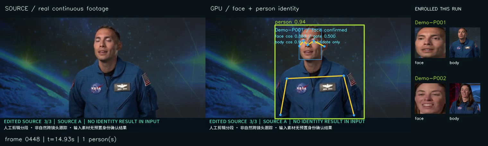
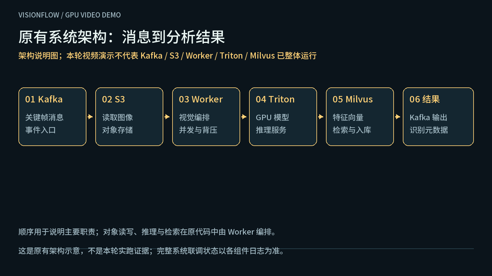

# VisionFlow

面向视频关键帧的异步视觉分析工程作品，与 `visionflow-inference` 配套。主仓展示有界并发、有序结果提交、视频结果与流程；推理仓展示 Triton 多模型服务、GPU 部署和模型制品追溯。

## 人脸＋人形身份确认：真实 GPU 视频

[打开身份展示页](demo/gpu/index.html) · [播放／下载身份确认视频](demo/gpu/identity-run-output/annotated.mp4) · [逐帧证据](demo/gpu/identity-run-output/events.jsonl) · [模型与运行清单](demo/gpu/identity-run-output/manifest.json) · [复现](demo/gpu/README.md)



本次在 RTX3090 上实际运行 **YOLO26m Pose＋YuNet＋SFace＋OSNet**：人脸检测、五点对齐和特征匹配确认匿名身份，再绑定人形框；专用 OSNet 人形特征提供候选匹配。15秒素材由两段 NASA 真人访谈明确剪辑成 A→B→A，模型实际得到 **Demo-P001→Demo-P002→Demo-P001**，不是预先写入素材的身份标签，也不声称自然跨镜头跟踪。

225个输出帧均经过GPU流水线；人形单独匹配不能覆盖人脸判断，无脸候选不会自动登记新身份。阈值是演示配置，不能据此宣称通用识别准确率或实名识别。来源、分段、分数、GPU推理计数与媒体摘要可核对。

## 两仓与流程



- **原有主流水线**：Kafka 关键帧 → 对象存储读图 → Worker → Triton GPU → 检测／特征与身份决策 → Milvus／Kafka 输出。
- **本次实际运行的展示路径**：真实视频 → 有界帧准备 → GPU 人形／人脸／特征模型 → 人脸确认与人形候选关联 → 按输入顺序提交身份状态 → 连续 MP4 与逐帧证据。

展示路径复用 `core/ordered_pipeline.py` 的并发与顺序提交机制，以及推理仓现有前处理／TensorRT／后处理四节点闭包。它不要求 Kafka、Milvus、PostgreSQL 或公司网络；架构示意图不等于这些服务已在本次视频中联调运行。

## 快速复现 GPU 展示

需要 NVIDIA GPU、匹配的 TensorRT engine、GPU 容器环境，以及同级目录的两个仓库。先在推理仓按其 `gpu_demo/README.md` 校验并准备模型，启动独立 GPU 服务；再按本仓[GPU 演示说明](demo/gpu/README.md)回放视频和生成浏览器可播放的结果。

```text
VisionFlow/                   # GPU 身份视频客户端、有界流水线、最终示例与流程图
visionflow-inference/         # gpu_demo/：模型校验、身份模型闭包、独立 GPU Compose
```

服务使用独立项目与本机端口 18010／18011／18012。模型权重和 engine 不提交 Git；准备工具检查来源、摘要与许可，拒绝不匹配的模型。公开身份演示选用许可有记录的 YuNet（MIT）、SFace（Apache-2.0）、OSNet 权重（作者仓库 MIT）和 YOLO Pose（AGPL-3.0）；不加载许可受限或未核实的其他身份模型。

## 可深入讲解的工程设计

| 设计 | 代码与文档 | 关键取舍 |
| --- | --- | --- |
| 有界并行准备、有序提交 | `core/ordered_pipeline.py`、`core/gpu_video_pipeline.py` | 输出按输入帧顺序；在途帧受并发＋lookahead 窗口约束 |
| 单 owner 与多视觉进程 | `core/multiprocess/` | 共享身份决策避免进程间身份竞态；不是高可用集群 |
| 版本化推理契约与组批 | `core/infer/` | 检查模型版本、形状和 batch；GPU 示例同时检查 native KIND_GPU |
| 首次向量持久化门控 | `utils/buffers/persistence_ticket.py` | 识别结果等待首份向量成功入库；不是跨 Kafka／Milvus 事务 |
| ReID 图库防污染 | `utils/reid/prototype_policy.py` | 身份锚点、冲突和离群过滤；未把受限权重放入默认公开演示 |

## 原有生产 Worker

原有 `main.py` 与根 Compose 保留为完整多模型环境的入口。它需要 Kafka、Milvus、对象存储、指定 Triton 模型及配置中的 PostgreSQL 参数；根 Compose 只启动 Worker。运行要求见[配置说明](docs/configuration.md)和[代码架构](docs/代码架构与处理流程.md)。

当前原有消费者仍在消息本地入队后提交 offset，异常可能丢失在途消息；不能声称至少一次或 exactly-once。GPU 视频回放入口不使用该 Kafka 消费链路。

## 开源与来源

项目自有代码沿用 [Apache-2.0](LICENSE)。不同演示模型分别采用 MIT、Apache-2.0 或 AGPL-3.0，保留独立许可和来源；GPU 驱动、CUDA、完整 TensorRT 与容器组件遵循各自条款，因此不把 NVIDIA 软件栈称为全栈开源。[第三方说明](THIRD_PARTY_NOTICES.md)。
