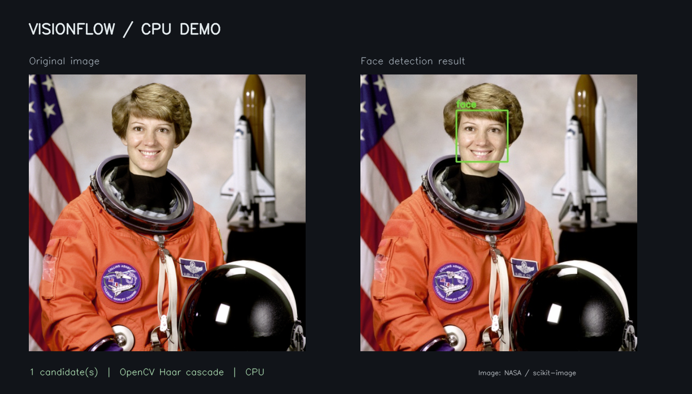

# VisionFlow

VisionFlow 是面向视频关键帧的异步视觉分析流水线。它从 Kafka 接收图片消息，经对象存储读取图片，调用推理服务处理人脸与人物，并将检测结果和向量元数据输出到 Kafka、向量写入 Milvus。

## 工作流程

```text
Kafka 关键帧消息 → 对象存储读取 → VisionFlow 视觉分析
                                      ├─→ VisionFlow Inference / Triton
                                      ├─→ Milvus 向量存储与检索
                                      └─→ Kafka 检测与识别结果
```

- **并发与背压**：多进程视觉处理、有界队列和资源池，控制图片、推理与输出阶段的在途工作量。
- **推理调度**：按模型组批并限制并发；支持通过 gRPC 调用符合既定契约的 Triton 模型。
- **身份处理**：支持人脸和人物特征分析、向量检索，以及有序提交和持久化门控。
- **运行观测**：输出阶段队列统计与链路计时，用于排查积压和吞吐瓶颈。

推理服务由同一作品中的 `visionflow-inference` 仓库提供；具体的模型、硬件和许可证要求以该仓库的说明为准。

## 演示效果



这张图由仓库提供的[独立 CPU 演示](demo/README.md)实际运行后生成：客户端发送图片到 VisionFlow Inference 的轻量 HTTP 服务，由 OpenCV Haar 级联分类器检测人脸，再保存标注图和 JSON。样例照片来自 NASA，经 [scikit-image 样例](https://scikit-image.org/docs/stable/api/skimage.data.html#skimage.data.astronaut)提供。

演示只展示人脸检测与跨仓库调用，**不启动 Kafka、Milvus、Triton 或生产 Worker**，也不代表生产模型的准确率。需要完整流水线时，请参照下面的运行要求。

## 运行

需要 Linux 或 WSL、Docker Compose，以及可访问的 Kafka、Milvus、Triton 和对象存储。现有 Compose **只启动 VisionFlow Worker**，不包含依赖服务和模型；还需要按配置要求提供 PostgreSQL 参数。准备的 Triton 模型必须满足[模型契约](docs/代码架构与处理流程.md#81-triton-模型契约)。

```bash
cp .env.example .env
# 编辑 .env，填写所选存储及各服务的连接信息
docker compose up --build visionflow
```

镜像基于 Python 3.12；Compose 使用宿主机网络和命名日志卷。配置文件、依赖服务、网络和模型契约就绪后，Worker 才能处理消息。详细环境变量和运维信息见[配置与运行说明](docs/configuration.md)。

> 当前消费者在消息进入本地队列后提交 Kafka offset，未等待图片处理与输出完成。进程异常可能丢失尚未处理的消息；请勿将现有行为视为至少一次处理保证。

新部署默认使用 `visionflow-*-record` 输出 Topic，额外人物转正设备列表默认为空。已有部署升级时，如需继续使用旧 Topic 或指定设备，请在环境变量中明确配置对应的五个 `KAFKA_*_RECORD_TOPIC` 和 `PERSON_UPRIGHT_DEVICE_SNS`；修改 Topic 还需要同步下游消费者。Milvus 集合名称未随此次调整更改。

## 文档

| 文档 | 内容 |
| --- | --- |
| [配置与运行说明](docs/configuration.md) | 连接、算法参数、并发和运行统计 |
| [代码架构与处理流程](docs/代码架构与处理流程.md) | 模块职责、处理顺序、模型契约和故障边界 |
| [Kafka Topic 契约](docs/kafka_topic.md) | 输入消息、输出字段及示例 |
| [人脸人型详细规则](docs/人脸人型详细规则.md) | 质量、身份确认和入库规则 |
| [人型 ReID 识别流程](docs/人型ReID识别完整流程.md) | 向量查询、身份分配和集合结构 |
| [SBS ReID 防污染机制](docs/SBS_ReID防污染机制.md) | 图库保护和排查入口 |
| [流水线队列统计与写出隔离](docs/流水线队列统计与写出隔离.md) | 阶段指标和输出积压 |

## 许可证与使用范围

本仓库采用 [Apache License 2.0](LICENSE)。模型权重、第三方依赖和容器镜像可能具有各自的许可证和使用条件，需分别核查。发布前应确认项目代码及示例数据的公开授权，并移除真实设备信息、凭据和内部地址。
