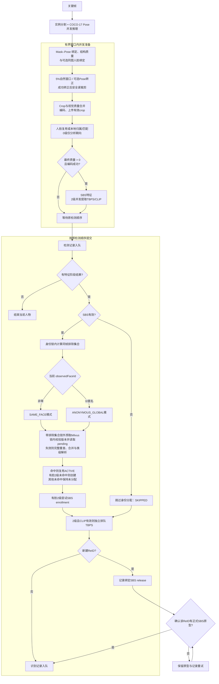

# 人型 ReID 识别完整流程

本文定义 SBS 的查询、ReID 分配、同帧互斥和原型持久化规则。检测、裁剪和质量门槛见[人脸人型详细规则](人脸人型详细规则.md)，进程调度见[架构文档](代码架构与处理流程.md)。

## 1. 总体流程



图中“质量 0”或 Pose 未匹配的有效非空 crop 仍会尝试上传，并只为脸部朝向执行必要的人脸检测/关键点；无效框或空 crop 作为准备失败结果按序提交检测记录。“质量 1”只提取 SBS 并识别已有 ReID，不写入 SBS/TBPS；“质量 2”才允许在当前观察到非零人脸且 SBS 有效时进入 SBS enrollment，TBPS/CLIP 写入独立判断。

人物准备以有界窗口并发执行，身份结果按原检测顺序提交。窗口限制与默认值见 [配置说明](configuration.md#并发与组批)。

## 2. 检测、姿态与 crop

实例 mask 与 Pose 一对一绑定后生成最终人物 crop。可靠 Pose 可用于转正；图像、mask 和 crop 内关键点共用坐标变换，整图检测框和关键点保留原坐标。所有后续模型和 OSS 使用同一最终 crop。

匹配门槛、转正启用条件、裁剪方式与质量限制统一见[人型质量规则](人脸人型详细规则.md#二人型质量与入库)。

## 3. 身型与质量等级

支持的身型：

- `full_body`
- `three_quarter_upper`
- `three_quarter_lower`
- `half_body_upper`
- `half_body_lower`
- `partial`
- `unknown`

`full_body`、`three_quarter_upper` 可以达到2级。`half_body_upper` 只有在可见点不少于 11、两肩两髋全部可见、双侧肩髋链完整且没有其他降级条件时可以达到2级。`three_quarter_lower` 只识别；其余不进入 ReID。

最终等级：

| 等级 | 动作 |
|---:|---|
| 0 | 丢弃，不提取身份特征、不查询、不写库 |
| 1 | 只识别已有 ReID，未命中保持未分配 |
| 2 | 识别；有当前观察人脸时允许创建/扩充 SBS；CLIP 有效时独立写 TBPS |

最终等级还受 mask、裁剪几何、多人物混入、真实截断和视觉质量限制。

## 4. crop 与 OSS

有效人物 crop 会尝试上传 OSS。成功时 object name 同时用于检测记录和 SBS 的 `cropUrl`；失败时这些字段使用空字符串。

上传失败不会阻断 SBS 特征提取、身份查询或符合条件的有脸2级 enrollment，也不会把整帧关键帧地址当作人物裁剪地址。

## 5. 特征职责

- SBS R50-IBN：在 Triton 模型预处理中把共享的可变宽高比 crop 直接缩放到固定输入 `384×128`，输出归一化 2048 维向量，唯一负责人物身份分配。
- TBPS/CLIP：在自身 Triton 模型预处理中把同一 crop 直接缩放到固定输入尺寸，输出 512 维向量，只用于检索，不参与 ReID 分配。
- 两条特征链独立降级，禁止在 SBS 失败时回退到 CLIP 分配身份。

## 6. crop 内人脸

人物观察的人脸 ID 来自同一最终 crop 内的可靠归属和身份匹配，或可靠同图人脸复用。本地绑定在 Face Identity Lock 内合并查询 `alogFace` 与 pending 样本，只复用已有 Face ID；未确认或异常时为 `0`。

人脸质量、灰区双样本确认及 `off/on` 复用条件见[人脸与人型规则](人脸人型详细规则.md)。成功转正的人物在启用复用时使用完整本地流程。

## 7. SBS 查询计划

SBS 从 `alogSBS` 和当前进程的正式 pending 原型中查询候选。

- 非零 faceId：只执行一次 `SAME_FACE` 查询，候选必须具有相同规范人脸；仍应用身型兼容与绝对相似度门槛。
- faceId 为 `0`：只执行一次 `ANONYMOUS_GLOBAL` 查询，并先按 ReID 独立完成候选聚合。
- 已知人脸未命中时不查询或修改匿名类；身份层可在质量2级时创建新的 ACTIVE ReID。

Milvus 和正式 pending 候选使用相同查询窗口与过滤规则。查询窗口为最近 7 天。

不同帧的 Milvus 候选检索可以在身份锁外预取；锁内先固定同帧排除和本进程版本，重新加锁后读取最新 pending 并校验图库实际写线程、版本与排除集合。仅稳定候选可进入原类级解析。候选不可用且当前版本稳定时，最多离锁刷新一次，重新加锁后再次读取排除集合和 pending、校验版本；仍不稳定、刷新失败或缺少版本能力时，保留一次完整锁内查询，不能仅在旧 top-k 上过滤。最终决策至 pending 登记始终保持原子性。查询显式使用 `Strong`，不修改集合默认一致性；版本不协调其他进程，锁内回退也不构成与后台 flush 的事务快照。详见[并发边界](代码架构与处理流程.md#64-特征准备与按序-reid-提交)。

## 8. 身型检索矩阵

| 查询身型 | 可查询图库身型 | 基础门槛 |
|---|---|---:|
| `full_body` | full / upper-three-quarter / upper-half | `>0.56 / >0.53 / >0.55` |
| `three_quarter_upper` | full / upper-three-quarter / upper-half | `>0.53 / >0.56 / >0.55` |
| `half_body_upper` | full / upper-three-quarter / upper-half | `>0.55 / >0.55 / >0.56` |
| `three_quarter_lower` | full / upper-three-quarter | 都 `>0.55` |

每种图库身型最多召回 50 个 ReID 分组，每组最多 3 个原型。Milvus 与正式 pending 合并时按 `(reId, prototypeId)` 稳定 UUID 去重，重复项取分数较高者，同分保留先出现的 Milvus 项；尚未完成通知而仍留在 pending 的已持久化原型不能重复提供支持。随后每个 ReID 最多取相似度最高的 3 个有效原型，类级分数为：

```text
0.60 × Top1 + 0.40 × TopKMean
```

## 9. 类级解析

同脸查询只在规范 faceId 与查询 faceId 相同的 ReID 中解析。候选超过身型基础门槛即可参与；多个兼容 ReID 时直接选择类级分最高者，不执行 ReID 类间 Margin，`requiredMargin=0.0`。因此胜出与次优 ReID 的 classScore 接近不会判为 `ambiguous_margin`，也不会因接近而创建新 ReID；仅在没有任何同脸兼容类时，质量 2 级观察才可按既有规则创建新的 ACTIVE ReID。

匿名查询先按 ReID 独立计算 TopK、双原型/单原型支持、均值和绝对门槛；随后按身份键折叠：非零且唯一的 `canonicalFaceId` 按 face 身份折叠，每个 faceId 只保留类级分最高的 ReID；无脸类按 ReID 身份键独立竞争。匿名查询额外要求：

- 同设备候选的 Top1 必须 `> 0.70`；跨设备候选的 Top1 必须 `> 0.74`；
- 含同设备支持的候选类的 TopK 均值必须 `> 0.66`；纯跨设备候选类的 TopK 均值必须 `> 0.70`；
- 普通类至少 2 个有效原型；
- 身份 Margin 保持 `>= 0.08`，且只比较不同身份键（通常为不同 faceId；无脸类按 ReID）；胜出后返回该身份键下类级分最高的 ReID；
- 具有非零规范人脸的唯一锚点允许单原型复用：同设备 Top1 `> 0.70` 或跨设备 Top1 `> 0.76`，且 `raw Margin（胜出 Top1 减去不同身份键的最佳 raw 候选分数）>= 0.15`；同脸其他 ReID 不作为 raw runner。

一个 ReID 含多个非零 faceId 的冲突类不能成为 scored 类或最终 winner；仅防御性作为独立 raw competitor 影响单原型 raw Margin。无脸类则按其 ReID 身份键独立竞争。

任何成功解析的候选都是 ACTIVE。

## 10. 同帧互斥

同一关键帧按原检测顺序提交身份结果并维护 ReID 占用表，准备/推理可以乱序完成。排除集合在身份锁内、查询前计算；当前人物必须与该 ReID 在本帧全部已分配实例都同时满足 bbox IoU 与 mask IoU `>=0.70` 才允许共享。mask 缺失、为空或尺寸不一致时按不同人物处理，已占用 ReID 会同时从 Milvus 和 pending 查询中排除。

排除后未命中时，匿名观察保持未分配；有脸2级观察可以创建新的 ACTIVE ReID。

## 11. 身份与 enrollment

| 场景 | `reidStatus` | `reidState` | `reidEnrollmentState` |
|---|---:|---|---|
| 命中已有 ReID | 2 | `ACTIVE` | 有脸2级时可为 `FORMAL_PENDING`，否则空 |
| 有脸2级未命中 | 1 | `ACTIVE` | `FORMAL_PENDING` |
| 匿名命中 | 2 | `ACTIVE` | 空 |
| 匿名未命中 | 0 | 空 | 空 |

`reidState` 只允许空字符串或 `ACTIVE`。`reidEnrollmentState` 只允许空字符串、`FORMAL_PENDING` 或 `REJECTED`。

`CREATE_NEW` 的识别记录绑定对应 SBS pending 项，确认该 ReID 至少有一个正式 `alogSBS` 原型后才放行；写入失败时保留重试。pending 原型使用跨重试稳定的 UUID，回执超时后按同一 UUID 强一致重查，避免重复插入。

命中已有 ReID 的记录直接入队，可能早于该身份的新生记录到达。`ACTIVE/FORMAL_PENDING` 表示身份决策和样本入队状态，不是当前样本的写入回执；Kafka 各 Topic 没有事务性顺序保证。记录绑定、重试和进程内单次放行见[缓冲与输出](代码架构与处理流程.md#84-缓冲与-kafka-输出)。

SBS enrollment 必须同时满足：

1. 最终人物质量等级为 2；
2. 当前人物 crop 实际观察到非零 faceId；
3. ReID 非空且状态为 ACTIVE；
4. SBS embedding 有效。

从已有 ReID 获得的规范人脸不能替代当前观察人脸。

## 12. 有界原型策略

- 新记录必须具有非零 faceId；
- 同一 ReID 已有多个规范人脸或新旧人脸冲突时拒绝；
- 与已有原型相似度 `>=0.95` 时跳过重复；
- 与类内最佳相似度 `<0.60` 时拒绝离群新模式；
- 每个 ReID 最多 24 个原型；
- 每个“设备 × 身型”域最多 5 个原型；
- 达到上限时只替换同域中冗余度 `>=0.90` 的原型；
- 无安全替换项或删除失败时冻结本次更新。

## 13. `alogSBS` Schema

`alogSBS` 使用 2048 维 embedding、7 天 TTL、调用方生成的 `VARCHAR(36)` UUID 主键和 `auto_id=false`。字段必须精确为：

| 字段 | 类型 | 含义 |
| --- | --- | --- |
| `id` | `VARCHAR(36)` | 原型 UUID 主键 |
| `faceId` | `VARCHAR(36)` | 非零当前观察人脸 |
| `reId` | `VARCHAR(36)` | ACTIVE 人物身份 |
| `bodyCompleteness` | `VARCHAR(32)` | 人体完整度 |
| `cropUrl` | `VARCHAR(512)` | 人物裁剪图 OSS object name，上传失败时为空 |
| `qualityScore` | `FLOAT` | 入库人物质量分 |
| `embedding` | `FLOAT_VECTOR(2048)` | 归一化 SBS 特征 |
| `deviceId` | `VARCHAR(255)` | 设备 ID，分区键 |
| `trackId` | `INT64` | 固定为 0，输入 trackId 不参与 ReID 判断 |
| `keyframeId` | `INT64` | 关键帧图片向量主键 |
| `personRect` | `JSON` | 原始人物检测框 |
| `timestamp` | `INT64` | 毫秒时间戳 |

已有集合在初始化时校验字段集合、`id` 的 VARCHAR 类型和 `auto_id=false`；检查不通过时失败，不自动删除集合。SBS 与 TBPS 使用各自独立的集合。

## 14. 主要诊断字段

- `reidDecision`：`MATCH_EXISTING`、`CREATE_NEW`、`UNASSIGNED` 或 `SKIPPED`。
- `reidDecisionReason`：如 `accepted`、`unique_face_anchor`、`ambiguous_margin`、`no_compatible_class`。
- `reidSearchMode`：`SAME_FACE`、`ANONYMOUS_GLOBAL` 或 `NOT_EXECUTED`。
- `canonicalFaceId`：命中类的规范人脸，没有则为 `0`。
- 输出字段：`reidTop1Score`、`reidMeanScore`、`reidClassScore`、`reidSupportCount`、`reidRunnerUpScore`、`reidMargin`、`reidRequiredMargin`；匿名 `reidMargin` 仅比较不同身份键，SAME_FACE 的 `reidRequiredMargin=0.0`。
- 内部诊断：`rawRunnerUpScore`、`rawMargin` 只存在于解析对象或日志信息，pipeline 不将其作为独立 Kafka 字段序列化；单原型 raw Margin 仅比较不同身份键。
- `sameFrameExcludedReidCount`：同帧互斥排除数量。

## 15. 模块职责

| 模块 | 职责 |
|---|---|
| `core/person_pipeline/` | 观察与同图人脸绑定、有界并发准备、按序身份提交 |
| `utils/reid/person_search.py` | 单次查询计划与候选合并 |
| `utils/reid/reid_resolution.py` | 类级解析 |
| `utils/reid/reid_rules.py` | 同脸与匿名规则 |
| `utils/reid/person_identity.py` | 匹配、创建、状态和 enrollment |
| `utils/reid/prototype_policy.py` | 有界原型更新 |
| `utils/buffers/sbs_feature_buffer.py` | 正式 pending、异步刷盘和裁剪地址转发 |
| `db/zilliz/SBS_feature.py` | `alogSBS` Schema、查询和持久化 |
