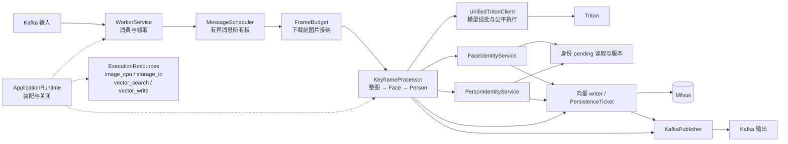
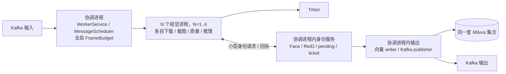
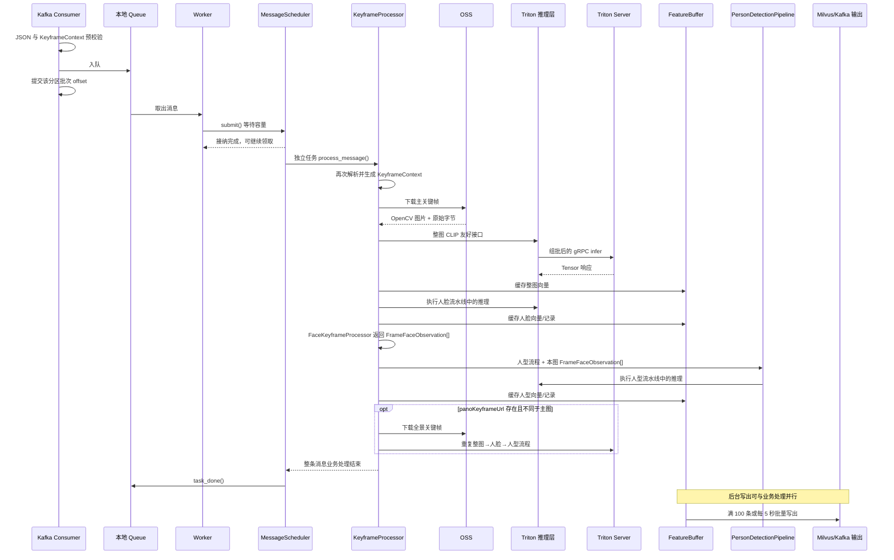
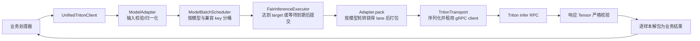

# VisionFlow 代码架构与处理流程

本文说明模块职责、执行顺序、并发和故障边界。运行配置见 [README](../README.md)，质量与身份规则、Kafka 字段见文末专题文档。

## 1. 系统定位

VisionFlow 是一个异步视觉分析 Worker，不提供 HTTP 业务接口。它的核心职责是：

1. 从 Kafka 消费关键帧消息；
2. 从所选 OSS 或 MinIO 下载主关键帧，以及可选的全景关键帧；
3. 调用 Triton 完成整图、人脸和人型推理；
4. 对人脸和人型执行质量分级与身份分配；
5. 把裁剪图写入同一所选对象存储、向量写入 Milvus、业务记录写回 Kafka。

上图说明单进程的业务组件关系；`VISUAL_WORKER_PROCESSES=0` 是受限环境可用的单进程装配。当前代码与模板默认 `VISUAL_WORKER_PROCESSES=4`，设置为 `N`（1..4）时，输入、身份与输出由一个协调进程（下文称 owner）持有，N 个视觉进程通过本机 IPC 调用它。`N=1` 也创建独立的 owner 与视觉进程。每个视觉进程独立连接同一个 Triton，原图、mask 和编码裁图留在所属视觉进程：

协调进程不创建 Triton、图像和存储执行池；视觉进程不创建 Milvus 客户端、身份 pending、输出 writer 或 Kafka producer。独立启动两套完整 VisionFlow 服务仍会各自拥有身份锁，不能当作此模式的共享身份实现。

生产入口导入模块不建立外部连接，进入所选运行时的启动流程才初始化客户端。PostgreSQL 配置仍校验，`main()` 没有创建其会话或调用 `check_db_connection()`。设备簇缓存 `db/pgsql/cluster_cache.py` 未接入主处理链路，人脸和人型检索默认跨设备查询，因此本轮不按设备分片身份 owner。

## 2. 代码分层与模块职责

| 层次 | 主要文件 | 当前职责 |
| --- | --- | --- |
| 进程入口 | `main.py` | 配置日志、信号和统计，进入应用生命周期并运行 Kafka 服务 |
| 应用装配 | `core/application.py` | 显式构建资源、Triton、数据库、存储、输出及业务服务；启动失败清理，关闭时等待真实资源结束 |
| 多进程装配 | `core/multiprocess/` | 协调/视觉角色装配，`spawn` 进程生命周期、本机 RPC、身份代理和全局帧预算 |
| 执行资源 | `core/execution.py`、`core/bounded_cpu_pool.py` | 四类有界执行端口、跨线程上下文与计时、真实线程完成后归还许可 |
| 向量查询调度 | `core/vector_query.py` | owner 内合并完全相容的 Face 查询，控制接纳、批次生命周期与结果路由；不持有身份状态，不新增线程池 |
| Kafka 服务 | `core/worker_service.py` | 消费、预校验、offset 提交、本地队列与领取任务生命周期 |
| 接纳与图片所有权 | `core/admission.py` | 输出水位接纳接口、下载前图片数量/估算预算以及原图字节观测 |
| 消息所有权 | `core/message_scheduler.py` | 独立限制已接纳消息数，持有真实业务任务，任务结束后确认本地队列完成 |
| 有序目标调度 | `core/ordered_pipeline.py` | 每帧限制 N 个同时准备与 N+M 个未提交项目，独立推进准备并按输入顺序提交 |
| 并行分支所有权 | `core/async_tasks.py` | `run_owned_parallel()` 汇合当前目标的分支；失败或取消时取消其余分支，并保护清理协程直到结束 |
| 单帧编排 | `core/keyframe_processor.py` | 解析消息、下载图片，按整图向量→人脸→人型的顺序编排主图和全景图 |
| 人脸流水线 | `core/face_keyframe_processor.py`、`core/face_observation.py` | 人脸检测与视觉准备、按序调用身份服务并构造记录，返回同图观察 |
| 人脸身份与端口 | `core/identity/` | 独立 Face 和人物 Face 解析共享锁/搜索协调；身份决策、pending 原子登记及新生写入意图；通过窄端口访问图库和输出 |
| 人脸候选预取 | `core/face_search_pipeline.py`、`utils/reid/face_search.py` | 短锁快照、锁外 Milvus 查询、锁内版本复核与最新 pending 合并；失效时完整重查 |
| 人型入口 | `core/person_keyframe_processor.py` | 组装人型流水线依赖，并把检测/识别结果转换为 Kafka payload |
| 人型流水线 | `core/person_pipeline/` | 将人型流程拆成观察、准备、特征与总编排四个阶段 |
| 推理门面与契约 | `core/infer/triton_client.py`、`contracts.py`、`results.py` | 对业务暴露 9 个友好接口，声明远程模型/Tensor 契约，并返回稳定的业务结果类型 |
| 推理适配与调度 | `core/infer/adapters/`、`batching.py`、`executor.py` | 校验/归一化输入，按模型和兼容形状组批，公平且有界地调度远程 batch RPC |
| Triton 能力与传输 | `core/infer/capabilities.py`、`transport.py`、`errors.py` | 启动时发现并校验远程模型能力，维护异步 gRPC 客户端池、超时/重试和统一错误类型 |
| 质量规则 | `utils/quality/` | 人脸质量、脸部/身体朝向、人型 Pose/Mask/Crop/视觉质量及分级决策 |
| ReID 规则 | `utils/reid/` | 人型候选检索、类级解析、身份分配、入库资格和原型更新策略 |
| 几何与解析 | `utils/keyframe/` | 输入上下文解析、框/Mask/Pose 绑定、人物裁剪与坐标变换 |
| 持久化与发布 | `utils/buffers/` | `FeatureBuffer` 兼容 facade；独立 pending view、向量 writer、Kafka publisher 与首次持久化 ticket |
| 数据访问 | `db/zilliz/`、`db/pgsql/` | Milvus collection 封装；PostgreSQL 会话与未接入主链路的设备簇缓存 |
| 存储与消息 | `utils/storage/`、`utils/records/` | 所选存储后端下载/上传，以及 Kafka 输出 payload 的统一构造 |

人型流水线内部的职责进一步拆分如下：

- `observation.py`：并发执行人物分割和人体 Pose，完成实例绑定，生成 `PersonObservation`；
- `preparation.py`：分别提供人物裁剪/转正、结构质量合并、视觉预检与编码，以及所选存储上传；两阶段通过 `PreparedPerson` 传递结果；
- `features.py`：人物 crop 内人脸匹配、SBS/TBPS 特征提取和 TBPS 入库排队；
- `face_reuse.py`：同图人脸与人物绑定、共享观察校验、复用/回退状态机和帧级统计；
- `pipeline.py`：用有界窗口并发准备人物结果，再按原检测顺序调用身份服务和提交记录；
- `models.py`：定义各阶段之间传递的不可变数据对象。

## 3. 进程启动、消费与退出

### 3.1 启动顺序

配置模块导入时加载并校验环境、算法档案和资源容量；不会因导入 `main.py` 创建数据库或网络连接。`main()` 设置 OpenCV 内部线程数为 1，配置日志/信号。默认四视觉进程模式进入 `MultiProcessRuntime`，启动顺序见 3.4 节；显式设置 `VISUAL_WORKER_PROCESSES=0` 时进入 `ApplicationRuntime`：

1. 创建 `ExecutionResources` 的 image CPU、storage I/O、Milvus search/write 四个有界执行端口；
2. 初始化 Triton，校验 9 个模型契约，启动模型组批与 RPC 执行器；
3. 在写资源端口初始化 `DatabaseServices`，先预热当前进程的 SDK 类型检查，再连接数据库并检查集合结构，随后创建所选存储客户端；
4. 构建独立输出组件并启动 Kafka producer、writer/publisher，装配 `FaceIdentityService`、`PersonIdentityService` 和窄端口驱动的 `KeyframeProcessor`；
5. 注册 `resources/frames/triton/output` 统计 provider，运行 `WorkerService`，创建容量 1000 的本地消息队列、`MessageScheduler`、consumer 和领取 worker。

启动任一步失败会清理已拥有的资源，原始启动异常继续传播。数据库初始化线程被取消时仍等待其真实结束并登记所有权，防止创建成功的客户端遗失。`db.zilliz` 与全局 buffer 的旧入口仅为延迟兼容；生产入口注入实际依赖，不使用导入时的全局客户端。

`DatabaseServices.create()` 在创建客户端之前调用 `db/zilliz/sdk_runtime.py` 的 `warm_search_dependencies()`，触发 `pymilvus.client.utils.SciPyHelper.is_scipy_sparse([])`。当前固定依赖 `pymilvus==3.0.1` 的 SciPy 惰性加载器首次初始化没有并发保护，预热使这一步在接纳消息之前完成，避免查询池首次并发搜索同时触发初始化；它不建立外部连接，也不执行向量查询。SciPy 未安装时沿用 SDK 的可选依赖行为；已安装模块初始化异常则直接使启动失败，不吞掉损坏依赖。此处使用 SDK 内部接口，升级 PyMilvus 时须复核接口和惰性加载行为。预热只作用于当前数据库服务所在进程，多进程模式由 owner 执行，不建立跨进程共享缓存。

consumer 默认订阅原三个输入 Topic；`KAFKA_INPUT_TOPICS` 可用非空、无重复的 CSV 覆盖。`ALOG_MAX_INFLIGHT_MESSAGES=0` 时消息容量继承 worker 数。`FrameBudget` 在每张图下载前另行接纳，`ALOG_MAX_INFLIGHT_FRAMES=0` 继承有效消息容量；启用 `FRAME_MEMORY_BUDGET_BYTES` 后，还按每帧 `FRAME_RESERVATION_BYTES` 的固定估算限制并发帧数。原图观测超过预留时只记录，不在持有图像后等待扩容。

### 3.2 消费与 offset 语义

`WorkerService` 的 `consume_messages()` 每次最多拉取 50 条消息；`main.consume_and_dispatch()` 仅保留旧工具兼容入口。每条消息先做 UTF-8 JSON 解析，并调用 `parse_keyframe_context()` 检查关键帧地址和必填 `uId`，合法消息再放入本地队列。

同一分区本批消息全部尝试入队后，consumer 立即提交到该批最后一个 offset 的下一位。提交动作不等待 worker 完成实际识别，因此这里的边界是“成功进入本地队列”，而不是“业务处理成功”：

- 本地队列已接收但尚未处理的消息，在进程异常退出后不会依靠 Kafka 自动重放；
- JSON 或上下文无效的消息会被跳过，随后也会随该批 offset 一起提交；
- 队列满时 `queue.put()` 会阻塞 consumer，形成进程内背压。

每个 worker 在领取下一条消息前检查输出高低水位：全部向量和 Kafka 队列的 queued + inflight 达到 `OUTPUT_BACKLOG_HIGH_WATERMARK` 时暂停领取，降至 `OUTPUT_BACKLOG_LOW_WATERMARK` 后恢复。在途帧继续完成，因此水位是入口软背压，不是输出内存硬上限。等待发生在身份锁之外；pending 是同一待写向量的检索视图，不重复计数。

worker 从本地队列领取后等待 `MessageScheduler.submit()` 接纳，接纳后继续领取；整条消息改由调度器拥有的独立任务执行。`ALOG_MAX_INFLIGHT_MESSAGES` 限制已接纳且尚未结束的消息数，覆盖该消息的主图及全景图；本地排队和领取后等待接纳的消息另行计数。这是按消息数量的执行上限，不是图片/目标数量或字节内存硬上限。多进程模式下调度器仍只在 owner 中运行，消息随后分配给视觉进程，不能为每个子进程重复建立同等全局消息额度。

接纳返回不表示处理完成：`queue.task_done()` 在真实消息任务结束时恰好调用一次，失败和取消也会回收所有权。消息处理正常返回可能包含内部已捕获的单图错误，因此不能把消息任务完成数等同于成功图片数。输入 offset 提交时机仍是本地入队之后，没有随调度解耦改动。

### 3.3 优雅退出

收到 `SIGINT` 或 `SIGTERM` 后，停止事件触发 `WorkerService` 关闭 consumer，等待本地队列 `join()`，结束领取 worker，再关闭并排空 `MessageScheduler` 的真实消息任务。随后 `ApplicationRuntime` 停止输出、刷新可成功批次并关闭 producer，关闭 Triton，排空四个执行资源池，最后关闭不再被线程使用的 Milvus 客户端。统计和日志在资源清理后停止。关闭调用方取消不应留下脱离所有权的线程或资源。

consumer 或领取任务发生非取消异常、或提前意外退出时，`WorkerService` 快速失败并清理任务，随后向外传播异常，交给进程监控/Compose 重启。此时不会无限吞掉异常继续消费：已接纳的业务任务等待收束，本地队列中未处理项计数并报告；其已提交 offset 的恢复限制仍然存在。单条消息内捕获的业务错误仍按对应图片失败规则处理，不与服务级故障混淆。输出刷新仍失败的内存项不能通过进程重启恢复。

### 3.4 一个 owner 与 1..4 个视觉进程

`core/multiprocess/runtime.py` 的 `create_runtime()` 选择运行模式，默认一个 owner 与四个视觉进程；0 仍是可用的单进程配置。`MultiProcessRuntime` 先校验全局预算和 N 份分账，再创建 owner 的 Milvus search/write 池、数据库、输出和 `OwnerIdentityHandler`。通过 `multiprocessing.get_context("spawn")` 启动 N 个视觉进程，每个进程内部创建事件循环、图像/存储池、存储客户端和 Triton channel。父进程不把已创建的网络连接、线程池或身份服务传给子进程。所有视觉进程均报告 ready 后，owner 才启动正常 Kafka 消费；启动等待受 `MULTIPROCESS_START_TIMEOUT_SECONDS` 限制。

`assembly.py` 将图像线程、有效存储线程、Triton 执行槽/等待区/客户端池、Face/Person 全局准备及人物 Face 并发按商余分给 N 个视觉进程，分账之和等于原配置总额。SHM 槽位总量及复制线程总量也分账；复制线程总额仍为 `min(4, 总槽位数)`，分到 0 槽的进程不创建 SHM 复制池。每帧准备并发不超过本视觉进程的全局准备容量，lookahead 保持配置值。必需的正数资源少于进程数时拒绝启动，不靠向上取整扩大总额度。Milvus search/write 只在 owner 创建一次；消息上限、`FrameBudget` 与可选帧内存估算预算也只在 owner 生效。

owner 选择当前在途消息数最少的视觉进程，不按单个资源配额加权。总图像线程为 4 时，3 进程分到 `2/1/1`，4 进程分到 `1/1/1/1`；不同 CPU 配额下相同消息数可能对应不同负载。增加进程数还会拆散按模型和输入 shape 形成的本地 batch，并增加进程、网络连接和缓存的固定开销。选择进程数时需要同时查看各进程有效配额、实际队列、组批和完整图片吞吐。Snowflake ID 在这一进程组内保留 owner worker ID 0，视觉进程依次使用 1..N；它不分配其他独立 VisionFlow 副本的编号。

视觉进程在下载每张图前通过 `RemoteFrameBudget` 申请全局 lease，主图释放后才能申请同一消息的全景图。owner 以运行代次和递增序号生成 work ID，并验证请求来自该 work 所属的进程。IPC 使用父子私有 socketpair，不创建网络监听端口；只接受双方白名单方法。每条消息的编码大小由 `MULTIPROCESS_IPC_MAX_PAYLOAD_BYTES` 限制。普通请求、等待新帧的准入请求和回复分别有数量及字节额度，避免所有请求都等待帧容量、导致持有帧的工作无法归还 lease。`MULTIPROCESS_IPC_MAX_REQUESTS` 与 `MULTIPROCESS_IPC_MAX_BYTES` 是每个 peer 的每类额度，不参与全局预算分账；增加视觉进程数会增加整组 IPC 额度，不能将其解释为固定的全局总量或整个进程 RSS 上限。

`identity.py` 与 `ports.py` 显式传递向量、质量、几何摘要、object key、frame ID、stage 和原始检测 ordinal，不传图片、mask、编码裁图、闭包或 `PersistenceTicket`。整图向量接纳后开始 Face 阶段，所有 Face ordinal 终结后才允许 Person；质量跳过也必须提交检测记录并终结该 ordinal。人物同帧 ReID 排除由视觉端使用原 bbox/mask 判定逐对计算兼容的前序 ordinal，owner 根据已经提交的 ReID 分配计算排除集，不能把非传递的兼容关系改成聚类。

Face/ReID 身份查询、版本复核、锁、pending 和首份向量持久化 ticket 均留在 owner。视觉端拿到 Face 身份回执后才继续该帧 Person 流程；新 ReID 记录通过不透明 receipt 绑定到 owner 的 ticket。已有身份记录仍直接入队，新生记录仍等待首次身份向量持久化确认。帧完成汇报要通过 owner 的阶段和唯一性检查；它表示整帧业务流程完成，不表示所有异步输出都已持久化或收到 Kafka ACK。相同 work 内的重复操作按操作键和内容摘要复用原任务，相同键但内容不同会被拒绝；work 结束时清除去重缓存和 receipt 映射，writer 仍继续拥有已登记的持久化任务。

调用 `process_message()` 的等待者取消后，真实视觉任务继续由运行时持有，不能提前释放消息或帧额度。正常停机先排空 work，再要求视觉进程关闭其资源；最后停止 owner 输出、排空 Milvus 执行池并关闭数据库。超过 `MULTIPROCESS_STOP_TIMEOUT_SECONDS` 或任一视觉进程意外退出/断连时，整组进入失败状态，停止继续接纳，不自动重启某一个子进程或把其任务交给其他进程重试。断连子进程必须确认实际退出，owner 已接受的操作也必须收束，之后才能清理 work 和归还其 lease。

多进程模式保留 3.2 节的输入 offset 语义，没有增加持久 inbox/outbox、owner 故障切换或崩溃自动重放。独立部署的进程监控可以重启整组服务，但不能恢复已经提交 offset 对应的内存工作，也不能提供 exactly-once。

## 4. 一条消息的主处理流程

### 4.1 消息解析

消息调度器调用 `KeyframeProcessor.process_message()` 后会再次解析 JSON，并由 `parse_keyframe_context()` 统一生成：

- `sn`：设备序列号；
- `timestamp`：事件时间；
- `object_name`：规范化后的 OSS object name；
- `keyframe_id`：输入 `uId`；
- `is_pano_keyframe`：是否为全景附图。

当前版本不执行设备 SN 白名单过滤。`process_payload()` 通过 `parse_keyframe_context()` 解析并校验关键帧上下文后，继续下载和处理主图；设备 SN 仅作为输出上下文，并用于后续 `EPS` 和 `PERSON_UPRIGHT_DEVICE_SNS` 人物转正判断。

### 4.2 主图与全景图

主图必须先成功下载并完成 `_process_keyframe_context()`，之后才解析可选的 `panoKeyframeUrl`：

- 全景图与主图共享 `keyframeId`、设备 SN 和事件时间；
- 每张图片各自生成独立的 `pictureVectorId`；
- 全景图上下文固定标记 `isPanoKeyframe=true`；
- 全景地址为空，或规范化后与主图相同，不重复处理；
- 主图下载失败会终止整条消息，因而不会再处理全景图；
- 全景图的解析、下载或处理异常会单独记录，不回滚已完成的主图结果。

### 4.3 单张图片的固定顺序

`_process_keyframe_context()` 对每张图片严格串行执行：

1. 从 OSS 下载图片；
2. 生成 `pictureVectorId`；
3. 提取整图 CLIP 特征并加入整图向量缓冲区；
4. 执行完整人脸流程，返回仅属于本图的 `FrameFaceObservation[]`；
5. 将该列表传给完整人型流程。默认人型仍在自身 crop 内独立做人脸处理；启用复用时只在唯一可靠的同帧绑定上使用共享结果，其他情况仍走完整本地路径。

整图特征提取通过类型化推理接口返回 `FeatureResult`。输入、排队、远程推理或响应校验失败会抛出异常并中断当前图片，人脸和人型都不会继续；若失败的是主图，整条消息（包括可选全景图）结束，若失败的是全景图，只记录全景处理异常。人脸流程如果有未被内部捕获的异常，也会中断本张图片，后续人型流程不会执行。

## 5. 人脸代码处理流程

入口为 `FaceKeyframeProcessor.process_detection()`，先做一次整图人脸检测，再以有界窗口并发执行 `_prepare_face()`，由 `_commit_face()` 按原检测顺序提交：

1. 校验检测框，生成原始与扩展人脸 crop，并完成扩展 crop 编码；
2. 并行执行扩展 crop 上传与视觉分析；视觉分支依次提取关键点、计算朝向、执行前置判断和质量分级。候选失败时保留失败原因，仍等待上传步骤结束，等轮到该人脸提交时发送 `status=0` 的检测记录；
3. 两分支汇合，非 0 级且 crop 上传成功时才提取并校验人脸特征；准备返回后释放全局准备名额。轮到该人脸提交时，先将检测记录入队；
4. 轮到提交时调用 `FaceIdentityService.commit()`；服务短锁取得候选版本，锁外预取 `alogFace`，再持同一身份锁合并最新 pending、复核版本；没有有效候选时最多再锁外刷新一次，仍不可用则完整锁内查询，最终持锁决定身份；
5. 满足质量和身份入库条件的特征加入 pending 与写入缓冲；新生识别记录等待该身份首次向量持久化确认，其他识别记录直接入队；
6. 返回仅属于本图的 `FrameFaceObservation[]`，供人型流程按配置复用。

上传与视觉分析由 `run_owned_parallel()` 统一持有和汇合；普通质量不通过是分支结果，不会取消上传。未捕获异常或调用方取消才取消其余分支，并等待协程清理。上传失败仍禁止独立人脸提取特征，不会因视觉分支先完成而绕过该门控。

`FaceIdentityService._resolution_scope()` 协调初次预取、候选复核及最多一次额外锁外刷新。初次候选缺失或失效时，若当前锁内能取得稳定版本、没有真实写线程活动且尚未刷新，先释放身份锁完成额外远程查询，再重新持锁读取最新 pending 并复核前后版本。起始预取被跳过或普通异常后也可以走这一次刷新；当前状态不可用时不等待 writer 空闲，而是立即使用原完整锁内查询。刷新普通异常、再次失效或无法产生有效结果，均最终回到原完整锁内查询，不继续刷新。

最终可用结果交给调用方后，身份锁一直覆盖 ID 决策、记录构造和 pending 登记；业务异常不会触发候选重查。`FACE_SEARCH_PREFETCH_ENABLED=false` 同时禁用初次预取和刷新。完整查询异常仍禁止创建 ID，取消直接传播。灰区证据不足禁止创建 ID；灰区双样本确认只复用身份，不扩充图库。具体阈值与容量策略统一见[人脸质量和身份规则](人脸人型详细规则.md)。

上述回退处理针对锁外初次预取/刷新普通异常或正常返回的无效候选。锁内 `resolve_prefetched()` 或刷新状态读取本身抛错时，直接形成终态查询错误，不再刷新或完整重查；`commit()` 阻止创建身份，人物内部 `search()` 向上传播异常。

Face 候选有效性同时跟踪本实例图库写版本和 pending 移除版本。真实同步写线程进入/退出都会更新图库版本，异步等待者取消不提前清除 active writer；读取最新 pending 后再次检查版本。新增 pending 由最新读取覆盖，实际移除才递增移除版本。稳定时沿用 Milvus 优先的合并次序与既有灰区去重；失效后的完整路径保持 pending → Strong Milvus → 合并解析。版本只覆盖当前实例，不提供跨进程事务或可跨帧复用的候选缓存。

`FACE_FRAME_CONCURRENCY` 代码默认 30，是每帧同时准备上限 N；`FACE_PREPARE_LOOKAHEAD` 默认 2，为额外前瞻容量 M。`run_ordered_pipeline()` 在启动准备前按检测顺序保留 N+M 个未提交名额，覆盖准备中、就绪等待和正在提交的目标。准备完成即可释放执行名额并补充后续目标，提交则每帧一次一个，队首准备完成即可开始，不等待整帧。M=0 保持原 N 项窗口；同帧串行需 N=1 且 M=0。上限按帧计算，全进程占用随并行帧数累计。

`FACE_GLOBAL_CONCURRENCY` 代码默认 100，在同一处理器的全部 worker/帧之间共享，覆盖裁剪、上传与推理，在身份提交前释放；代码与两个配置模板的 N、全局准备上限及 M 统一为 30、100、2。后序准备失败会停止继续接纳目标，前序仍按顺序提交，到失败项时再抛错并回收后序任务；提交失败或调用方取消则取消并等待剩余任务退出。已提交结果不回滚。

检测记录和同图观察不等待新生识别记录发布。已捕获的特征失败仍会在提交阶段发出检测记录；身份搜索失败不撤回已入队的检测记录。未捕获的准备异常到达提交位置时，该失败项及后序不再发布检测或识别记录；帧被取消时未提交项也停止提交。此前已提交结果和已完成的裁图上传不回滚。

## 6. 人型代码处理流程

人型入口为 `PersonKeyframeProcessor.process_detection()`，实际编排在 `PersonDetectionPipeline`。整帧分割/Pose 绑定完成后，`_prepare_observation()` 以有界窗口并发执行裁剪、质量、人脸匹配和特征推理；`_commit_observation()` 再按原检测顺序提交结果。同帧 ReID 互斥由按序身份提交和共享身份锁共同保证。

### 6.1 Observation：分割、Pose 和初始质量

`PersonObservationService.detect()` 同时发起：

- 人物实例分割 `extract_person_segments()`；
- COCO 17 点姿态 `extract_person_poses()`。

人物分割 v3 在线路上返回动态容量的 `DETECTIONS`、位打包的 `MASK_CROPS_PACKED [B,M,160,20]` 和 `NUM_DETECTIONS`。`PersonSegmentationAdapter` 严格检查动态容量与零填充，仅将有效人物槽按 big bit order 解包为 `160×160` 二值 mask，再按裁剪后的 bbox 大小执行最近邻插值，返回带整图坐标原点的局部 `PersonMask`，不分配整图 mask 画布。业务通过 `PersonMask.data`、`count(bounds)`、`window(bounds)` 访问局部像素和指定坐标窗口，不直接对 `PersonMask` 做 NumPy 索引或转换。随后，分割与 Pose 结果按 bbox IoU 与可见关键点落入实例 mask 的比例进行一对一绑定，并为每个人物构造 `PersonObservation`，其中包含检测框、mask 像素数、置信度、Pose、身体朝向、结构质量初判、`aiId` 和检测时间。

分割推理异常会中断人型流程；Pose 异常会被降级为空 Pose，并继续为分割实例生成观察对象，后续质量规则通常会把它判为 0 级。

应用入口把分割/Pose 绑定及该帧全部观察对象的构建合并为一次 `image_cpu` 有界任务，包含身体朝向和结构质量评估，结果保持原检测顺序。线程只读输入图像、mask 和 Pose；绑定字段写入该帧新建的 segment 字典，日志和性能聚合仍在事件循环执行。独立朝向评估器也显式注入图片执行器并负责关闭。

### 6.2 Preparation：裁剪、质量合并和 OSS

`PersonPreparationService.prepare_visual()` 只完成视觉准备，依次执行：

1. 根据检测框生成四边 5% 的自然窗口；
2. 对全景图，或设备 SN 包含 `EPS`（不区分大小写）或命中 `PERSON_UPRIGHT_DEVICE_SNS` 手动名单的主图，尝试基于可靠 Pose 将人物转正；手动名单用于额外开启其他设备，清空名单不影响自动启用规则；
3. 将目标 mask、其他人物污染、补边、截断等 crop 质量与结构质量合并；
4. 非 0 级样本继续做清晰度、曝光和对比度视觉预检；
5. 编码最终人物 crop，返回带质量与编码结果的 `PreparedPerson`。

`upload_prepared()` 是独立上传阶段，使用同一编码结果和所选存储后端，通过 `dataclasses.replace()` 返回带 crop 地址的 `PreparedPerson`，不修改视觉分支正在读取的对象。原 `prepare()` 签名保留，顺序调用视觉准备和上传以兼容独立调用。流水线在视觉准备完成后，将“上传后匹配人脸”与符合质量条件的 SBS/TBPS 特征提取并行，避免上传等待串行阻塞人体特征推理。上传失败保留空地址，仍按原规则允许符合条件的特征提取与 SBS enrollment；不创建新执行池或资源配置。

检测框无效或裁剪为空时生成 `PersonPreparationFailure`，等轮到该人物提交时再发出失败检测记录。视觉预检自身异常只记录日志，并保留此前的结构质量结果继续处理。

### 6.3 crop 内人脸与同图复用

`PersonFeatureService.match_face()` 使用最终 crop、对应 mask 和变换后的 Pose 判断人脸归属。非 0 级且编码成功时执行质量、特征和图库搜索；0 级只分析脸部朝向。搜索在 Face Identity Lock 内合并 `alogFace` 和 pending 样本，本地绑定只复用已有 Face ID。

整图流程返回的 `FrameFaceObservation[]` 仅属于本图，主图和全景图分别绑定。默认 `on` 采用可靠共享结果并固定复用到特征阶段；`off` 作为紧急开关，完整使用本地流程。成功转正的人物在启用复用时仍强制本地处理；共享结果不可靠、为零或发生异常时也回退。阶段校验、门槛和朝向坐标转换见[同帧人脸复用状态机](人脸人型详细规则.md#同帧整图人脸复用状态机)。

每张正常处理完成的图片输出一条 `Person face reuse frame summary`：

| 日志字段 | 含义 |
| --- | --- |
| `mode`、`people`、`frame_faces`、`bound` | 模式、人物数、整图人脸数和绑定数 |
| `direct`、`partial`、`orientation` | 共享尝试的成功来源 |
| `fallback`、`fallback_recovered` | 本地处理次数，以及共享不可用后由本地取得非零 ID 的次数 |
| `id_shared_only`、`id_local_only`、`id_different` | 仅共享非零、仅本地非零、两侧非零但不同；三者之和为 `id_disagreement` |
| `orientation_disagreement` | 两侧均为已知 `front/side` 且不同的次数，排除 `unknown/no_face` |
| `fallback_reasons` | 按原因名排序的 `reason:count`，以竖线分隔，空时为 `none` |
| `rotated` | 最终 crop 成功转正的人物数 |
| `shared_success_rotated/unrotated`、`fallback_rotated/unrotated`、`recovery_rotated/unrotated` | 各前缀分别有 `_rotated` 和 `_unrotated` 两个键，按 crop 是否成功旋转统计共享成功、本地处理和非零恢复 |

模型请求数与延迟由 Triton executor/batch 日志记录。非 0 级且编码成功的样本并行执行“上传后人脸匹配”与人体特征提取，两分支汇合后生成 `PersonAnalysis`；身份判定仍等待人脸结果。0 级或空编码样本跳过人体特征分支，仍完成上传步骤（空编码不发送图片）后，以 `enable_recognition=False` 执行脸部朝向分析，轮到提交时只输出检测记录。未捕获异常或取消时，通过 `run_owned_parallel()` 取消并等待其余分支退出。

### 6.4 特征准备与按序 ReID 提交

准备阶段对通过质量门控且已编码的 crop：

1. 始终尝试提取 2048 维 SBS 特征；
2. 只有 2 级样本才同时提取 512 维 TBPS/CLIP 特征；
3. 收集两条特征链各自的结果/失败原因，并等待并行的上传及人脸匹配分支完成，再连同最终 crop 地址组成 `PersonAnalysis`。

人物使用同一 `run_ordered_pipeline()`：N 为 `PERSON_FRAME_CONCURRENCY`，M 为 `PERSON_PREPARE_LOOKAHEAD`（默认 2），每帧同时准备最多 N 项、未提交合计最多 N+M 项。准备完成即可继续补充，提交中的项目也占总容量；M=0 保持原窗口，串行需 N=1 且 M=0。失败和取消的清理规则与人脸相同。

提交阶段依次等待首个人物，先入队检测记录，再调用 `PersonIdentityService.assign()`。SBS 特征无效时该服务直接返回 `SKIPPED` 及失败原因，不执行身份查询；有效时才进入身份锁。后序人物即使更早完成推理，也需等待自己的提交顺序；首项准备完成即可提交，不等待整帧全部推理。人物整体任务寿命仍计入 `person_prepare`，视觉准备与 embedding 各自取得原 `PERSON_GLOBAL_CONCURRENCY` 名额，Face 解析由 `PERSON_FACE_CONCURRENCY` 限制（0 继承前者）。`person_visual_prepare` 只覆盖 `prepare_visual()` 或 `extract_embeddings()`，不覆盖上传与 Face 等待；`person_face_match` 的等待和活动单列。上传只占原 `storage_io` 额度，其任务寿命仍受当前目标 N+M 窗口约束；移除视觉名额的上传等待后，存储排队中的任务数可能增加，帧与目标窗口上限仍保持原值。两分支汇合后才能按序提交身份。

身份提交采用带版本校验的候选预取：先在短 `person_identity_lock` 内固定同帧排除集合和图库/pending 移除版本，再释放锁查询 Milvus。不同帧可重叠远程查询，每帧仍只在原检测顺序轮到该人物时调用 `assign()`，不额外创建预取任务；在途消息受 `ALOG_MAX_INFLIGHT_MESSAGES`（0 时沿用 `ALOG_WORKER_COUNT`）限制，每请求仍按身型矩阵提交 2–3 个查询分支。

重新取得身份锁后，复核排除集合，读取最新正式 pending，再复核版本。实际写线程活跃、版本变化或排除集合变化时废弃预取；若当前可取得稳定版本且尚未刷新，则固定最新排除集合、释放锁再查询一次，并重新取得身份锁复核。每次重入都重新读取排除集合，不能沿用刷新前的快照。起始未能预取但进入提交锁时写线程已结束，也可使用这一次刷新机会。再次失效、刷新普通异常、实际写线程仍活跃或缺少版本能力时，保留一次完整锁内查询，不等待 writer 空闲或无限重试。

稳定时合并候选、解析身份、登记非零 ReID；最终版本检查到登记之间不让出事件循环，符合条件的 SBS enrollment 继续在锁内。初次预取错误直接传播；新增刷新普通异常仅触发原完整查询，完整查询仍失败时禁止分配身份；取消直接传播。候选复核或业务决策本身的异常不触发刷新。查询和分配规则见[人型 ReID 识别完整流程](人型ReID识别完整流程.md)。

图库版本在实际同步写线程入口和 `finally` 出口更新，使用独立短线程锁，覆盖等待写互斥锁及异步等待者取消后的真实写入寿命。pending 仅在实际移除时递增版本，新增由提交时的最新 pending 读取覆盖。SBS 候选查询显式使用 `Strong`，集合默认一致性不变；已写入但尚未移除 pending 的同一原型按稳定 UUID 去重，高分优先、同分保留 Milvus 来源，不能重复计支持数。

这些版本只覆盖当前实例的写入，不能提供跨进程事务。状态变化后的锁内回退保留原有 Milvus→pending 查询顺序，不隔离后台 flush；原有回退路径中的读/迁移窗口仍存在，不能将预取校验描述为所有候选来源的事务快照。

只有“最终 2 级 + 当前观察到非零人脸”才允许创建或扩充 SBS；1 级和匿名观察只复用已有 ReID。

TBPS 与 SBS enrollment 相互独立：2 级且 TBPS/CLIP 特征有效就会排队写入 `alogTBPS`，即使 SBS 未命中、`faceId=0` 或 `reid=0` 也不阻塞。最后流水线汇总人脸、ReID 和质量诊断信息；命中已有 ReID 的识别记录直接发送，新生 ReID 的识别记录则与 SBS pending 项绑定，只有首个正式原型写入 `alogSBS` 成功后才发送，失败时随原型重试且成功后只发送一次。

## 7. 阶段数据对象

人型流水线通过显式数据对象传递状态，避免阶段之间依赖零散参数：

| 对象 | 产生阶段 | 主要内容 |
| --- | --- | --- |
| `KeyframeContext` | 输入解析 | 设备、事件时间、OSS object name、业务 keyframe ID、是否全景图 |
| `FrameFaceObservation` | 整图人脸流程 | 来源框/关键点、质量、特征、Face ID、完成阶段及失败元数据，仅本图有效 |
| `FrameFaceBinding` | 同图人脸绑定 | 当前人物可用的唯一整图人脸观察，或未绑定/歧义原因 |
| `PersonObservation` | Observation | segment、bbox、mask/Pose 摘要、朝向、初始质量、检测标识 |
| `PreparedPerson` | 视觉准备 / 上传 | 最终 crop、投影后的 mask、合并质量、编码字节；上传阶段补充所选存储的 crop 地址 |
| `FaceMatchOutcome` | 人脸匹配/复用 | 当前观测 Face ID、脸部朝向，以及共享来源、回退原因和对比诊断 |
| `PersonEmbeddingBundle` | 特征阶段 | SBS/TBPS 特征及各自失败原因 |
| `PersonAnalysis` | 并发准备完成 | `PreparedPerson`、人脸结果及可选特征结果，等待按序提交 |
| `PersonPreparationFailure` | 准备失败 | 原人物观察和失败说明，等待按序提交失败检测记录 |
| `IdentityRequest` | ReID 编排 | 身型、质量、当前人脸、向量、设备、关键帧和排除集合 |
| `IdentityOutcome` | 身份服务 | ReID、状态、决策、诊断指标，以及新生 ReID 的持久化放行对象 |
| `FaceIdentityRequest/FaceIdentityOutcome` | Face 编排与身份服务 | 当前观察向量/质量/写入元数据，以及身份、分数、状态和失败原因 |
| `PersistenceTicket` | 新生 Face/ReID 写入意图 | 绑定记录、持久化确认与单次放行，处理先写库/后绑定的竞态；`SbsRecognitionRelease` 保留兼容别名 |

## 8. 推理、持久化与输出

### 8.1 Triton 模型契约

`MODEL_CONTRACTS` 使用稳定业务 key 声明 9 个远程模型。业务代码通过 `UnifiedTritonClient` 获取类型化结果，由适配器解析 Triton Tensor 字典：

| 业务 key | 用途 | 模型名 | 友好输出 |
| --- | --- | --- | --- |
| `clip_image` | 整图特征 | `clip_ensemble_trt` | `FeatureResult`，512 维整图向量 |
| `face_det` | 人脸检测 | `yolov8n_face_ensemble` | `list[FaceDetection]` |
| `face_kps` | 人脸关键点 | `face_keypoint_2d106_ensemble` | 由 106 点转换出的 5 点 `ndarray` |
| `face_qa` | 人脸质量 | `face_qa_ensemble` | `FaceQualityResult` |
| `face_rec` | 人脸特征 | `face_recognition_pipeline` | `FeatureResult`，512 维人脸向量 |
| `person_seg` | 人物分割 | `yolo26s_seg_ensemble` | `list[PersonSegment]`，动态实例数和带原图坐标的 ROI `PersonMask` |
| `person_pose` | 人体姿态 | `yolo26m_pose_ensemble` | `list[PersonPose]`，COCO 17 点 Pose |
| `sbs_image` | SBS ReID | `sbs_r50_ibn_image_ensemble` | `FeatureResult`，2048 维人物身份向量 |
| `tbps_image` | TBPS/CLIP | `TBPS_clip_image_ensemble` | `FeatureResult`，512 维人物检索向量 |

启动时会对每个模型调用 `is_model_ready`、`get_model_config` 和 `get_model_metadata`，同时校验模型名、声明的契约版本、输入/输出 Tensor 名称、数据类型、维度，以及配置的目标 batch 不超过远程 `max_batch_size`。`face_qa` 为契约 v2，输入 `RAW_FACE_IMAGE` 和扩展人脸图局部坐标下的五点 `LANDMARK`；`face_det`、`person_pose` 为采用七档固定矩形补边的契约 v2；`person_seg` 为契约 v3，沿用该补边规则并输出按位打包的 `MASK_CROPS_PACKED`。这三个检测模型仍接收原始 BGR 图像。`sbs_image`、`tbps_image` 为契约 v2，接收 `IMAGE_BYTES` BYTES；`clip_image`、`face_kps`、`face_rec` 为 v1。9 个模型并发发现，任一失败会汇总为 `TritonContractError` 并终止启动。

### 8.2 单次推理请求的内部流程

关键边界如下：

- 每个模型有独立调度器，只有 `compatibility_key` 相同的请求才会组批。原始图片通常要求形状和 dtype 一致；编码图片使用 BYTES 数组，各元素保留独立长度；
- batch 达到目标大小或等待到期后发出。数值数组在打包时连续化，单样本连续数组使用批维度视图；调用方在推理 `await` 完成前不得修改输入；
- 全模型共享 `FairInferenceExecutor`，按模型队列轮转；同一模型可占用多个执行槽。等待区满时立即抛出 `InferenceUnavailable`，不创建容量等待者。每个新批次只唤醒一个空闲 lane；出队、取消排队项和活动计数变化不唤醒其他空闲 lane。关闭及故障状态变化仍广播，保证排空和退出；
- 排队期限从 scheduler 收到请求起计算，覆盖凑批和执行器等待；远程 RPC 开始后使用独立推理期限；
- `TritonTransport` 管理共享 gRPC 客户端池，仅 `InferenceUnavailable` 可按配置额外重试；
- 调用方取消等待中的请求时将其移出队列；已经执行的 RPC 完成后回收 client。执行器在任务结束时释放局部引用，调用方持有的结果保持有效；
- 输入错误、排队超时、远程超时、服务不可用和响应不符合契约分别映射为 `InferenceInputError`、`InferenceQueueTimeout`、`InferenceServerTimeout`、`InferenceUnavailable`、`InferenceResponseError`。

配置默认值、模板值和约束统一见 [README 并发与组批](../README.md#并发与组批)。

曾用于回放的 Jetson Triton 配置中，Pose/Seg 使用 `max_batch_size: 4`、两个 GPU 实例及 `dynamic_batching {}`；该服务端配置并未包含在本仓库中。VisionFlow 的默认目标 B4/2 ms 负责客户端组批，服务端能否合并不同视觉进程送来的请求取决于实际部署，两层等待与批大小须分别观测。VisionFlow 启动只验证远程配置/metadata 契约，TensorRT engine 的真实批能力还须由服务端构建和运行验证。

服务端模块在 Triton 仓库中分工如下：

| 模块 | 职责 |
| --- | --- |
| `scripts/yolo_request_batching.py` | CPU 侧逐请求校验、同形状分组、有界组包和按原请求拆分响应；无 CUDA 依赖 |
| `scripts/yolo_orin_pipeline.py` | 持有 GPU 预处理、TensorRT 与后处理资源，在一次 `execute(requests)` 内执行分组；完成 stream 同步后返回结果 |
| `scripts/yolo_orin_metrics.py` | 记录真实 TensorRT enqueue 尝试/失败、执行组失败，以及主机组包/拆分和 H2D/D2H 逻辑复制量 |

同组要求 `RAW_IMAGE` 的 H/W/C 一致、总 B≤4；不拆分单个 RPC 的批，不跨 `execute` 保留请求。额外主机组包最多 96 MiB，单个 RPC 无需额外拼接。非法输入按请求失败；执行前取消只剔除该请求，执行中的取消在共享 GPU 工作同步后分别返回。响应按原 RPC 的 batch 和顺序还原，Seg 对每个原 RPC 单独恢复 `max(1, max(NUM_DETECTIONS))` 槽数，保持 packed mask、padding 和 Tensor 契约；返回数组具有独立且连续的主机内存。身份状态及 Face→Person 顺序不进入此模块。

`yolo_orin_trt_calls_total{batch_size="1".."4"}` 在 `execute_async_v3` 边界记录 enqueue 尝试，失败另列 `yolo_orin_trt_failures_total`；不能把 Triton Python `execute` 次数当作 GPU 推理次数。`yolo_orin_group_failures_total` 记录已校验执行组失败，`yolo_orin_copy_bytes_total` 的 direction 包括 `host_pack`、`host_split`、`input_h2d`、`output_d2h`。这些复制量不包含驱动流量或元数据，且与业务图片数、客户端 RPC 次数不是同一单位。

### 8.3 Milvus collection

| Collection | 内容 | 写入条件概述 |
| --- | --- | --- |
| `alogPictureClip` | 整图 512 维向量 | 整图特征提取成功 |
| `alogFace` | 人脸 512 维向量、质量分和观察标识 | 人脸达到 2 级、crop 上传成功且满足身份入库条件；按容量、质量和采集时间择优保留 |
| `alogSBS` | 人物 2048 维 ReID 原型 | 最终 2 级、当前观察到非零人脸，并通过原型策略 |
| `alogTBPS` | 人物 512 维 TBPS/CLIP 向量 | 最终 2 级且特征有效 |

`FaceGallery.insert_embeddings()` 先校验整批输入，再在同一个 `_quality_update_lock` 中按原输入顺序处理。每个 `faceId` 在本批首次出现时使用 Strong 查询读取历史 metadata；后续同 ID 样本复用本批已经确认的 metadata 视图，只有 delete/upsert 确认后才更新该视图。任何异常都会结束本批并丢弃视图，重试与下一批重新 Strong 查询。`sampleId` 幂等、容量与质量择优规则、整个真实 writer 操作的 revision 范围保持不变；该锁不协调独立 owner 对同一集合的并发写入。metadata 查询次数尚无业务指标，回放报告记为 NA，不能从写入返回值推导或新增持久化返回字段。

### 8.4 缓冲与 Kafka 输出

由应用持有的输出 facade `FeatureBuffer` 的默认刷新触发条件为“单类达到 100 条”或“每 5 秒定时刷新”。服务启动后，4 个向量 writer 和 5 个 Kafka publisher 分别拥有对应队列，前台 `add_*` 只入队并唤醒任务，不再等待整批写出。每个队列的后台与显式 flush 共用锁，避免重叠取批；同一队列中的 Kafka 发送仍逐条确认。未调用 `start()` 的独立工具保留阈值同步刷新兼容性。一次显式 `flush_all()` 按两阶段排空成功批次，遇到失败保留待重试项：

1. 并发写入人脸、SBS、TBPS 和整图向量；
2. 并发发送人脸检测、人脸识别、人型检测、人型识别和向量元数据记录。

后台失败重排后等待后续触发，不因队列仍超过阈值自行空转。停止先等待已开始的 writer，再按上述两阶段排空；停止调用方取消不会取消真实在途写入。仍写失败的项会在停止日志中报告数量，数据仅保留在进程内存，没有新增持久恢复日志。

Milvus 成功返回向量主键后，才会构造对应的向量元数据 Kafka 记录。人脸和 SBS 在正式刷盘前还维护 pending 集合，使同一进程中的后续请求能立即检索到新身份，避免 5 秒窗口内重复建 ID。

新生人脸和 ReID 都通过 `PersistenceTicket` 将待发布记录与首次身份向量持久化确认关联；`SbsRecognitionRelease` 是兼容别名。Face pending 读取/版本、向量写入、Kafka 发送各有独立组件，身份服务不访问 writer 队列或 producer。SBS pending 入队时预生成稳定原型 UUID；超时重试时用强一致查询确认该 UUID 是否已落库，已落库则补齐记录/元数据通知，不再重复插入。如果同 ReID 的后续原型先写成功，也可在处理原始 pending 项时据此放行创建记录。记录绑定与写库完成的先后顺序都受 release 锁保护，进程内成功放行后不会再次调用新生记录回调。

按序提交是流水线内部顺序，不保证 Kafka 跨 Topic 或新生/命中记录的到达顺序：命中 pending 身份的记录可直接入队，新生记录仍等待落库。`ACTIVE/FORMAL_PENDING` 表示身份决策和样本入队状态，不能作为本次样本的 Milvus 写入回执。

业务记录发送采用逐条 `send_and_wait()`：若中途失败，只把尚未成功发送的记录重新放回队列；向量写 Milvus 失败也会把该批数据重新入队。当前没有死信队列，也没有跨进程事务来原子保证 OSS、Milvus 和多个 Kafka topic 同时成功。

### 8.5 链路计时与日志

`core/queue_metrics.py` 默认每 5 秒向 `logs/pipeline_stats.jsonl` 写一条独立阶段快照。记录正在等待/活动的任务、等待年龄、周期完成速率和输入/消息/CPU/Triton/输出各队列数量；成功退出、失败和取消路径都会清理计数。`queues.messages` 包含 `capacity_messages`、`inflight_messages`、`admission_waiters`、`closed`；`message_admission` 记录接纳等待。`face_commit/person_commit` 记录实际提交活动，`face_identity_snapshot` 记录短锁，`face_search_prefetch` 记录锁外 I/O。CPU 的 inflight 保留尚未真正完成的线程任务。字段定义、不同计数单位和恢复边界见[队列统计说明](流水线队列统计与写出隔离.md)。

`core/performance.py` 在进程内聚合耗时，默认每 5 秒输出 `ALog performance summary: {JSON}`。单进程资源由 `ApplicationRuntime` 统一拥有；默认多进程模式将 image/storage 资源分给视觉进程，search/write 与 Face 查询调度器只在 owner 创建。以下为代码与配置模板一致的全局默认容量：

| 资源端口 | 配置及默认线程数 | 承担工作 |
| --- | --- | --- |
| `image_cpu` | `IMAGE_CPU_WORKERS=4` | 原图解码、人物裁图/转正/结构和视觉质量、编码、向量归一化及达到复制阈值的推理组包 |
| `storage_io` | `STORAGE_IO_WORKERS=64`，其中下载保底 4 | 所选对象存储的阻塞下载/上传 |
| `vector_search` | `MILVUS_SEARCH_WORKERS=16` | Face/SBS Milvus 检索，含各身型并行查询分支 |
| `vector_write` | `MILVUS_WRITE_WORKERS=4` | Milvus 初始化、写入和图库原型更新 |

每个资源域记录 `<name>_run`、`<name>_queue_wait`，共 8 项，分别测真实线程执行与提交前名额/线程等待。线程真实结束后，由所属 loop 的完成回调释放许可；调用方取消不会提前回收任务。`inflight_jobs` 是已提交且尚未由该回调回收的数量，包含线程已结束但回调仍在等待的任务，不能直接当作瞬时 CPU 占用线程数。同一池最多提交其线程容量的真实工作，其他调用在 loop 中等待。不同资源域互不占用许可。业务仍需检查上游等待与完整吞吐，池隔离本身不保证速度提升。

异步 Face 查询统一经过 `VectorQueryCoordinator`，由数据库所在的单进程或 owner 创建并显式注入图库；缺少调度器时明确报错。`MILVUS_QUERY_BATCH_SIZE` 默认 4、允许 1..32；值为 1 只改变每批向量数，不切换接纳、取消或关闭路径。图库封装查询协议，调度器只接纳单向量请求，按 client、维度及所有 SDK 参数的类型/内容分组。collection、anns_field、metric/search_params、filter、limit、output_fields、分区和 consistency 的任何差异均不能忽略。兼容请求形成 `MilvusClient.search(data=[...])`，按原向量索引还原响应，结果槽位数不匹配会使整批明确失败，不静默截短。Face/pending 合并与最终版本复核仍在原身份服务；共享 RPC 不构成身份事务快照。

凑批等待由 `MILVUS_QUERY_WAIT_MS` 控制（默认 1 ms，0..10），`MILVUS_QUERY_CAPACITY`（默认 128，至少 batch size）包含已接纳排队及真实在途向量；达到容量后向现有上游窗口背压。取消未提交项会移除该项；提交后取消只终止调用者等待，原执行池持有 SDK 工作到真实结束，调度器同期保留额度。关闭按调度器→执行池→数据库的顺序排空。SBS 继续使用原精确过滤和每身型独立召回额度，未接入跨请求微批；本轮也未新增锁内回退优先级或更细粒度 revision。

`queues.resources.vector_queries` 记录 accepted/completed/failed/cancelled 查询数、finished RPC 与 nq、batch 直方图和当前等待/在途。`vector_query_admission_wait`、`vector_query_batch_wait` 按单向量统计前段等待，`vector_query_rpc_run` 按批次统计 SDK 执行，与 `vector_search_run` 重叠。搜索池等待仅是后段，不能因等待移到调度器就判定性能改善；SDK 自身超时也不包含前段排队。

原有 `image_decode/image_decode_queue_wait` 与 `person_crop_prepare/person_crop_prepare_queue_wait` 作为同一次线程工作的分项计时保留。它们分别不含下载，以及不含裁图之后的视觉检查、编码、上传。`person_observation_build/person_observation_build_queue_wait` 记录每帧分割/Pose 绑定、朝向与初始结构质量构建的执行和排队，不含推理请求及模型输出解包。这些分项与 `image_cpu_*` 存在重叠，不能相加。`person_seg_unpack` 仍是事件循环中分割结果单样本解包的同步耗时，`event_loop_lag` 是周期探针相对计划唤醒时间的延迟。

`UnifiedTritonClient` 向各模型调度器借出同一 `image_cpu`，不会在关闭推理门面时关闭应用拥有的池。预计复制量达到 1 MiB 的非连续 numeric 输入或多样本 numeric 堆叠每批进入线程池一次；连续单图 `B=1` 和 encoded bytes 包装保留同步路径。逐请求 DEBUG 的 `pack_ms` 只计真实组包执行，`pack_queue_wait_ms` 计 CPU 许可/调度等待并加入 `queue_total_ms`，计时数据回到事件循环更新；这两项未加入 `inference_by_model` 周期汇总，资源域自身仍有聚合计时。该边界释放大数组复制期间的 loop 调度机会，不保证单次组包提速；输出校验和 `unpack_one` 不改变执行位置或异常语义。

`main()` 在启动资源前调用 `cv2.setNumThreads(1)`，控制算子内部并行；应用层并发由资源池及业务窗口决定。`get_image_by_oss_name`、`KeyframeProcessor`、`PersonKeyframeProcessor`、`PersonDetectionPipeline` 和 `PersonPreparationService` 要求显式注入 `image_executor`，解码、裁图、视觉质量和编码共用有界的 `image_cpu`。旧解码/裁图惰性池及 `IMAGE_DECODE_WORKERS`、`PERSON_PREPARATION_WORKERS`、`IO_THREAD_WORKERS` 已移除；存储容量由正值 `STORAGE_IO_WORKERS` 明确指定，生产入口不设置 loop 默认执行器。独立朝向评估器用 `IMAGE_CPU_WORKERS` 创建一个 `AsyncWorkExecutor`，共享给 observation、preparation 和 matcher，并在正常结束、异常和取消时关闭。

`queues.frames` 记录有效帧数、等待/在途帧、估算 reserved bytes 与 observed image bytes。后者仅为当前 lease 的解码原图 `nbytes` 加压缩字节，不包括 mask、crop、Tensor、SDK 内存或已取消但真实线程仍引用的图片；固定预算默认关闭，也不是 RSS 硬限。`ApplicationRuntime` 在下载之前接纳，图像流程结束/取消即释放 lease，不在持有原图时等待追加预算。

同机部署可通过 `TRITON_SYSTEM_SHM_SLOTS` 显式开启系统共享内存输入，默认 0；单槽 `TRITON_SYSTEM_SHM_SLOT_BYTES` 默认 32 MiB，总容量上限 512 MiB。该路径要求异步 RPC、两端共享 IPC，并启用 Triton 的 `--allow-client-shm=true`。仅 `face_det`、`person_seg`、`person_pose` 的大尺寸 `RAW_IMAGE` 使用独占槽，其他输入和输出保持原协议。槽不可用或尺寸超限时回退原传输；输入复制进入独立有界线程池。已发送尝试发生异常或取消时，除下述明确注册丢失的有限修复外，都将槽隔离直到关闭，后续重试成功也不复用，避免覆盖服务端仍可能读取的图片。关闭先排空本地工作，再注销和释放本进程拥有的共享区域。它减少输入序列化和网络复制，不表示 GPU 零拷贝。

SHM 候选必须是所列三个契约的单个 `RAW_IMAGE`、至少 1 MiB、不大于单槽的本机字节序数值数组，并通过 `np_to_triton_dtype` 与契约 datatype 核验；不适用时保留原 SDK 输入校验及异常分类。槽独占期从借出开始，覆盖复制、客户端名额等待和 RPC，成功请求归还后才可写入下一张图片。复制池最多 `min(4, 槽数)` 个真实在途任务，取消已提交复制会等其真实结束再释放槽；未发出 RPC 就取消的槽可继续使用。隔离之后，`UNAVAILABLE` 的后续重试改用原传输，旧区域不再覆盖、扩容或补建。

Triton 重启可能清空服务端注册表而保留客户端 SHM。唯一可修复情形是当前正常租约收到 `StatusCode.NOT_FOUND`，且 SDK message 精确等于 `Unable to find shared memory region: '<当前槽 name>'`。独立控制 client 只读查询完整注册表，确认自身 name 缺失后重新注册同一个 name/key/size；原输入 Tensor、像素与独占租约保持不变，不再次复制，并对当前图片最多额外重发一次。该机会跨瞬态重试共享。注册表显示自身仍存在、返回格式无法确认、修复失败或修复后的重发失败，均执行原有隔离规则；不匹配错误不会查询或注册。SDK 空状态 `{}` 表示无注册；有注册时 `regions` 为按 name 索引的 map。

修复使用配置 RPC 的超时。控制注册一旦提交，即使调用方重复取消，也先等该注册真正结束再释放租约，防止关闭先注销而迟到注册重新生效。关闭开始后不再发起修复注册或修复后的推理；在途租约保证控制 channel 和 region 存活至修复排空。修复不创建新 region，不操作其他客户端的区域，也不回收历史隔离槽；升级前已隔离的槽仍需随本轮服务更新重启恢复。

`triton_shm_copy_queue` 测申请复制线程名额至工作线程开始的等待，`triton_shm_copy_run` 测线程内公开 SDK 复制调用；两者都在真实任务完成后回到事件循环聚合。`triton_shm_used` 记录采用 SHM 的 RPC 尝试，包含修复后的额外重发，不能当作成功请求数。`triton_shm_fallback` 在启用 SHM 后，为准备阶段未使用槽的每次推理调用计数，包含其他契约、BYTES、小图、超槽、无空槽等；隔离槽后每次原传输重试另计一次，部分输入可能在随后校验失败而未发送。`triton_shm_poisoned` 对每个首次隔离的槽计数一次。`triton_shm_reregister_attempt` 计进入修复流程（含状态查询），`triton_shm_reregistered` 计注册完成且允许重发，`triton_shm_reregister_failed` 计拒绝、异常或取消。以上六项是零耗时事件，只解释 `count`，`used + fallback` 不能作为严格 RPC 总数，`fallback` 不能推导槽不足比例。修复完成不等于后续推理成功。

逐请求 DEBUG 的 `serialize_ms` 覆盖首次输入准备的墙钟时长。SHM 路径包含复制池等待、实际复制、事件循环恢复和输入对象构造；绕过显式 `start()` 时还可能包含首次 SHM 初始化。它不等于事件循环阻塞时间，也不覆盖 SDK 在 `client.infer()` 内的全部 protobuf/gRPC 构造。异常后原传输重试的重新构造发生在 RPC 调用路径，额外耗时计入 `rpc_ms`；注册修复的状态查询、重新注册及额外推理也计入该时间。`rpc_attempts` 对修复后的推理重发另计一次，不将控制查询或注册当作推理尝试。周期汇总目前按模型聚合组批、执行器等待与 RPC，没有单独聚合 `serialize_ms`。

`request_bytes` 仍按原输入 Tensor 的逻辑 payload 统计，包括通过 SHM 传递的数组；它不是 gRPC 报文或网络流量测量，开启 SHM 后不应期待该值按减少的网络复制量下降。

代码与模板保留 0 槽和 Compose `ALOG_IPC_MODE=private`，可直接用于跨机器 Triton。本机同机配置为 16 槽 × 32 MiB，共 512 MiB，两端 IPC 为 `host`；默认四视觉进程各分到 4 槽，复制线程全组最多 4 个。最多 16 个大图 RPC 同时借槽，其余即时使用普通传输。该容量不保证完整图片 QPS；需以同一输入核对完成速率、事件循环延迟、复制排队、隔离计数及实际内存。

`face_identity_lock_wait` / `person_identity_lock_wait` 只统计成功取得身份提交锁的等待；对应 `*_hold` 统计该次锁内处理。人型正常预取不计入提交锁持有时间，失效后的完整回退查询计入。前置快照的短锁单独使用 `person_identity_snapshot_lock_wait/hold`；评估总锁占用时须加上两段 hold 的累计值，不能仅比较平均值。

`person_identity_requests` 计有效 embedding 的逻辑请求开始次数，`person_identity_locked_search` 计最终完整锁内查询次数/耗时。`person_identity_prefetch` 包含初次和一次额外刷新；`person_identity_refresh` 单列刷新，两者不能相加。`person_identity_prefetch_used/fallback/skipped/failed` 只读取 count，分别表示稳定候选复用、候选复核失效、起始状态不可预取、锁外查询普通异常。fallback 后可先刷新，不等于锁内查询；一次请求最多有两次提交锁等待/持有，`person_identity_search` 也按每段持锁搜索计数。`person_identity_refresh_used/invalid/failed/unavailable/exhausted` 区分刷新通过、失效、普通异常、无刷新条件和刷新后仍回退。`person_reid_milvus_search` 同时包含初次、刷新与回退，这些客户端耗时不能等同于 Milvus 服务端计算时间。

Face 初次快照短锁单独计为 `face_identity_snapshot_lock_wait/hold`，`face_identity_prefetch` 包含初次和额外刷新两种锁外查询；`face_identity_refresh` 单列额外刷新，因此两者计时不能相加。`face_identity_prefetch_used/fallback/skipped/failed` 仅解释 count：稳定复用、候选复核失效、起始预取不可用、锁外预取普通异常。fallback 后可能先刷新，不直接等于完整锁内查询；skipped 后若取得身份锁时写线程已结束，也可能刷新。取消直接传播，不记 failed。`face_milvus_search`、`face_pending_search`、`face_match_resolve` 统计对应查询/解析耗时，包含适用的初次预取、刷新和回退。

`face_identity_requests` 计逻辑解析开始，包括后来失败/取消的请求；`face_identity_locked_search` 计最终完整锁内查询的次数和耗时。刷新分项 `face_identity_refresh_used/invalid/failed/unavailable/exhausted` 分别记录刷新候选通过复核、刷新候选失效、刷新普通异常、当前没有刷新条件、一次刷新后仍进入完整锁内查询。关闭预取时仍有 requests、locked_search 和 unavailable。一次请求可有两次身份锁等待/持有和两次候选失效；不能沿用旧版 used/fallback/skipped 的合计推算逻辑请求或锁内查询数。各指标的精确边界见 [performance_tools 指标说明](../performance_tools/README.md#4-读取结果与耗时)。

`face_identity_lock_wait/hold` 由 `FaceIdentityService` 统一记录，覆盖独立 Face 提交和人物内部 Face 复用/回退的最终持锁路径；相比旧版本新增了后者的计时，A/B 比较时须注明口径变化。`stages.face_identity` 覆盖两条路径；快照短锁仍单列，不能把嵌套阶段计数相加为独立目标数。

身份锁内 `FaceSearchService` 的完整查询分别记录 `face_identity_locked_full_pending/milvus/resolve`；预取候选复核分别记录 `face_identity_locked_prefetch_pending/resolve`。这些是当前持锁协程的墙钟时间，含异步等待和调度，嵌套在锁持有及原有搜索指标中；锁外搜索与自定义搜索回调不计入这些分项。分项跨周期完成时不能直接用同一周期的次数和平均值推算其他指标，详细边界见 [performance_tools 指标说明](../performance_tools/README.md#4-读取结果与耗时)。

锁内完整人脸查询进一步按请求记录 `face_identity_locked_query_admission/batch/executor/sdk/resume`，依次覆盖接纳等待、入队至选批、选批至工作线程启动、SDK 调用和 SDK 返回至调用协程恢复。协调器在每条查询上捕获锁归属；同批锁外请求不计入，多个锁内请求共批时会重复记入共享批次的计时。取消后不会为该查询记录后续的线程/SDK/恢复耗时，也不会提前释放真实工作的容量。查询数据、身份和过滤条件不进入新增指标。

SBS 多类 gallery 检索通过 `gather_timed_threads` 使用显式注入的 `vector_search` 资源执行并统一等待。每路独立复制 context，结果顺序、上下文及异常传播保持不变，锁外预取与锁内回退使用同一检索实现；取消排队中的 Future 可以阻止执行，已运行的线程继续完成。`sbs_search_thread_queue` 测提交至线程开始，`sbs_search_thread_run` 测线程内客户端调用，`sbs_search_loop_resume` 测线程结束至 loop 计时回调执行的延迟。计时回到 loop 聚合，取消调用方后仍运行的检索也计数。

`sbs_search_group_wait` 测整组创建到调用方恢复的等待。完整成功组按最后执行 Future 完成回调的分支关联五段：提交前调度、线程排队、线程执行、Future 完成回调延迟、整组恢复；五段合计本组等待。Future 完成回调延迟不代表逐分支 `await` 续体恢复，也不能将并行分支的平均耗时相加当作持锁时间。失败或取消组不生成完整关键路径。指标只进入低频聚合，不保存请求或身份信息，具体名称与边界见 [performance_tools 指标说明](../performance_tools/README.md#4-读取结果与耗时)。

推理计时按模型聚合，逐请求明细降为 `DEBUG`；警告和错误仍单独输出。`batch_wait_ms` 从批内最早请求入队起计时，到派发协程实际开始执行为止，包含主动凑批以及事件循环调度延迟；`executor_queue_wait_ms` 和 `client_wait_ms` 分别统计后续执行器与客户端池的等待。修改组批等待配置不能保证消除调度延迟。

终端和文件日志使用 Loguru 后台队列，正常退出时等待统计任务和日志队列完成。消息完成与图片完成为业务流程口径，Milvus 批量写入和各输出 Topic 仍保持上述异步规则。`performance_tools/` 中的 Kafka 回放工具独立读取历史消息快照，回放时生成新的业务 ID，并明确区分输入发送量、关联输出量与持久化向量确认量。

### 8.6 多进程指标与回放口径

owner 的 `pipeline_stats.jsonl` 增加 `queues.multiprocess`，包含运行模式、失败标志、有效 work 数以及各视觉进程的 PID、活动任务、IPC 额度和最近一次资源快照。owner 保留 `resources/frames/output`，图像、存储、Triton 的资源快照来自视觉进程，不能将各子进程的计数冒充单个全局上限。worker 配额和最近快照需要一并核对，空闲时的低 GPU 利用率也不能只靠增大消息窗口解释。

每个视觉进程写独立的 `visual-1.log` 至 `visual-N.log` 性能日志，以及与 `PIPELINE_STATS_PATH` 同目录的 `pipeline_stats.visual-1.jsonl` 至 `pipeline_stats.visual-N.jsonl`（实际文件名前缀沿用配置路径）。子进程不共同写 owner 的统计文件。视觉端每张图完成后通知 owner，owner 在阶段校验后更新 `replay_runs` 的唯一完成计数；历史 Kafka 回放的完整图片吞吐读取 owner 日志。子进程性能日志用于定位图像、存储、组批和推理等待，不能再把它们的完成量加到 owner 完成量上。

对象存储下载与裁图上传共用 `storage_io` 执行池，由独立的 `core/storage_execution.py::StorageWorkExecutor` 管理分类准入。`STORAGE_DOWNLOAD_RESERVED_WORKERS=0` 保持原准入；正值在同一线程总预算内限制上传上限为 `storage_workers - download_reserved`，下载仍可使用全池，保底空闲时也不借给上传。上传等待不占线程。此值小于有效存储容量，多进程按商余分配，且下载保底及剩余上传容量均至少等于视觉进程数；不允许通过向上取整扩大总预算。存储SDK适配器仍负责后端、重试、object key及异常处理，业务身份顺序不变。

分类上传任务由存储执行器持有，调用方取消立即结束自己的等待；未提交线程的工作取消准入，已提交工作复用底层真实 Future 的 `drain_on_cancel`，线程结束后才释放上传名额。关闭拒绝新工作、唤醒分类等待者，并等待线程池和所持上传任务排空；取消一次关闭等待不会中断后台关闭。`queues.resources.storage_io` 新增 `download_reserved_jobs`、`upload_capacity_jobs`、`upload_admission_waiters` 和 `admitted_uploads`。后者表示已获分类名额的上传任务，可能仍等待全池许可；保底为0时不创建分类任务，后两项为0。`queued_jobs` 汇总分类等待与全池等待，`inflight_jobs` 仍只计底层真实提交。

`storage_io_run` / `storage_io_queue_wait` 保留整个池的执行和等待总计；`storage_download_run` / `storage_download_queue_wait` 只统计下载，`storage_upload_run` / `storage_upload_queue_wait` 只统计上传。上传的总池与分类 queue 指标均包含上传准入等待，不能因多了一道分类准入而漏计。四个分类指标在同一次实际执行上附加计时，不创建额外线程池；它们是总指标的分类，不能再与 `storage_io_*` 相加，否则会重复计算。取消后未提交的工作不生成实际线程计时；已提交后取消仍在真实结束时计时。执行耗时包含网络、SDK 和线程内操作，不等同于对象存储服务端内部耗时。

owner 的帧 `reserved_bytes` 是全局固定估算。实际原图字节在视觉端 lease 中观测，读取 `queues.multiprocess.workers[].queues.frames.observed_image_bytes` 或各视觉进程统计；owner 只在释放 lease 时收到该数，不能把 owner 周期中的 `observed_image_bytes=0` 解读为没有在途图像。这些字节均不包括所有 crop、mask、Tensor、SDK 缓存或已取消但仍执行的线程引用，不能当作 RSS 硬限。

验收以同一批历史 Kafka 输入、同一暖图库快照、相同全局资源配置，顺序比较单进程与两视觉进程。两视觉进程在该轮共享一个 owner 的测试身份库；A/B 两轮分别使用全新隔离命名空间，避免先跑的一轮改变下一轮初始图库。先确认全部唯一帧完成，再确认向量/记录队列排空和 Kafka ACK；资源均值使用同一个完成时间窗。回放工具与边界见 [隔离历史 Kafka 回放](../performance_tools/ISOLATED_REPLAY.md)。有限样本和无真值图片集只能验证该负载下的处理一致性与吞吐，不能单独证明身份准确率或达到目标 50 QPS。

## 9. 并发与一致性边界

| 范围 | 约束 |
| --- | --- |
| 多消息 | 领取 worker 与业务消息任务分离；owner 调度器限制全局在途消息，单进程共享一个处理器，多进程在 N 个视觉处理器间分配 |
| 单消息 | 主图先于全景图；每图按整图向量、人脸、人型顺序执行 |
| 图片接纳 | 下载前获取帧 lease；数量和可选固定字节估算共同限制接纳，不作为全进程内存硬限 |
| 人脸准备 | 整图检测一次，编码后上传与关键点/质量并行，汇合后仅对上传成功的合格样本提特征；每帧最多 N 个同时准备、N+M 个未提交项目，准备完成即释放全局名额 |
| 人脸提交 | 每帧按原检测顺序提交；后序准备失败不打断前序，到失败位置再停止；提交失败或取消回收剩余任务 |
| 人物准备 | 分割/Pose 并发；裁剪/质量/编码后，“上传再匹配人脸”与合格样本的 embedding 并行；每帧最多 N 个同时准备、N+M 个未提交项目，视觉与 Face 解析分别限额，上传只占原 storage 额度 |
| 人物提交 | 每帧按原检测顺序提交，提交中也占总容量；其他帧独立推进，失败边界与人脸一致 |
| 模型推理 | 每个视觉进程内各模型独立组批并共享该进程的执行器和客户端池；多进程按总额度分账，排队与远程超时独立 |
| 人脸身份 | 短锁取版本、锁外预取；无有效候选且现态稳定时最多一次锁外刷新，最终锁覆盖复核、最新 pending、分配与登记，仍不可用或禁用时完整锁内查询 |
| 人型身份 | 短锁固定排除与版本，锁外检索；提交锁内复核、读取 pending、解析、分配和 SBS enrollment，失效时锁内完整查询 |
| 持久化 | OSS、Milvus、Kafka 分别写入；进程崩溃可能丢失已提交输入 offset 对应的缓冲数据 |

单进程的身份锁和 pending 只在当前进程内生效。启用本项目的多进程模式后，所有视觉进程的身份请求统一进入同一个 owner，复用同一组 Face/ReID 锁、pending 与持久化门控；它不协调另外独立启动的 VisionFlow 实例，也不提供跨 owner 的身份分片或故障切换。

`run_owned_parallel()` 只管理当前目标内的分支，不新增队列、线程池或并发额度。某分支出现未捕获异常，或父任务被取消时，它取消其余分支，并通过受 `shield` 保护的清理协程等待分支退出；重复父取消也不会截断这段清理。底层 SDK/CPU 线程仍归原执行池持有，真实线程结束后才归还许可；该协程边界不承诺停止已开始的网络调用，也不回滚已完成上传、已提交记录或向量。每帧按序提交、Face 完成后才进入 Person，以及新身份首次持久化门控均保持不变。

## 10. 主要失败边界

| 失败点 | 当前行为 |
| --- | --- |
| 配置值不合法 | `Settings` 导入时失败；不会进入 `main()` |
| Triton 服务/模型未就绪或远程契约不兼容 | 推理门面初始化失败；不会启动 Kafka consumer 和业务处理 |
| 输入 JSON、关键帧地址或 `uId` 无效 | consumer 记录错误并跳过；本批 offset 仍会提交 |
| 主图 OSS 下载失败 | 结束整条消息，也不处理可选全景图 |
| 整图特征输入、排队、远程推理或响应失败 | 中断当前图片；主图失败时不再处理人脸、人型和全景图，全景图失败时不回滚主图 |
| Triton executor 等待区已满 | 新形成的 batch 立即收到 `InferenceUnavailable`；具体业务影响由调用点的异常边界决定 |
| Triton 排队或远程推理超时 | 分别抛出 `InferenceQueueTimeout` 或 `InferenceServerTimeout`；已经开始的 RPC 不受排队期限影响 |
| 未捕获的人脸流程异常 | 中断本张图，后续人型不执行 |
| 人脸向量库检索异常 | 当前脸输出未分配识别记录，不创建人脸 ID/向量；返回带失败元数据的观察，人型复用需按可靠性规则回退 |
| 人脸/人型单个候选质量失败 | 尽量发送失败检测记录，然后结束该候选 |
| Pose 推理失败 | 保留分割结果，但后续通常因 Pose 质量门控降为 0 级 |
| SBS 特征失败 | 跳过 ReID 分配，仍发送带原因的人型识别记录 |
| TBPS 特征失败 | 不影响 SBS 身份分配，只在识别记录中补充失败信息 |
| 人物准备/提交阶段未捕获异常或取消 | 取消并等待窗口内剩余异步任务，停止本帧后续人物提交；已提交结果不回滚 |
| 新生人脸/SBS 首次写入失败 | 当前进程保留向量和关联新生记录重试；确认持久化前不放行创建记录 |
| 全景图失败 | 记录异常，不回滚主图结果 |
| Milvus/Kafka 批量写出失败 | 当前进程内重新入队，等待下次刷新 |
| 单消息业务处理异常 | 记录异常并结束该消息；由于 offset 已提交，不依赖 Kafka 重放 |
| consumer/领取任务非取消异常或意外退出 | 服务快速失败，清理并向外传播，交进程监控重启；报告尚未处理的本地输入，不自动恢复已提交 offset |
| 视觉进程退出、IPC 断连或协议损坏 | 多进程整组失败，停止接纳并收束子进程和 owner 已接受的操作；确认进程退出后回收帧额度，不自动分发重试 |
| 多进程操作重复或乱序 | 同 work、同操作键且内容一致复用原任务；内容冲突、跨 work 回执、Face 未结束即开始 Person 或 ordinal 乱序均拒绝 |
| 多进程正常停机排空超时 | 终止视觉进程，收束 owner 操作后关闭输出、执行池和数据库；报告失败，不声称已提交输入均完成 |

## 11. 阅读与修改建议

排查一条消息时，建议按以下顺序阅读日志或设置断点：

1. `core.worker_service.consume_messages()`：消息是否通过预校验并入队；
2. `KeyframeProcessor.process_payload()`：关键帧上下文是否解析成功，是否存在全景图；
3. `KeyframeProcessor._process_keyframe_context()`：OSS、整图、人脸、人型走到哪一步；
4. `UnifiedTritonClient._submit()`、对应 `ModelBatchScheduler`、`FairInferenceExecutor` 和 `TritonTransport` 日志：请求是否完成归一化、组批、准入、client 租用和远程 RPC；
5. `FaceKeyframeProcessor.process_detection()` 或 `PersonDetectionPipeline._prepare_observation()` / `_commit_observation()`：候选级质量、推理结果与按序身份提交；
6. `PersonIdentityService.assign()` 和 `PersonReidSearchService.search()`：ReID 查询、类级决策与 enrollment；
7. `FeatureBuffer.flush_all()`：数据是否真正写入 Milvus 和 Kafka。

修改模块按第 2 节的职责划分；外部契约同步更新对应专题文档，配置同步维护 `core/config.py`、`.env.example` 和 README。

## 12. 相关专项文档

- [Kafka Topic 字段契约](./kafka_topic.md)
- [人脸与人型质量分级及入库逻辑](./人脸人型详细规则.md)
- [人型 ReID 识别完整流程](./人型ReID识别完整流程.md)
- [SBS ReID 防污染机制](./SBS_ReID防污染机制.md)
