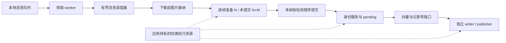

# 流水线队列统计与写出隔离

## 查看统计

默认文件为进程工作目录下的 `logs/pipeline_stats.jsonl`；容器中为 `/app/logs/pipeline_stats.jsonl`。每 5 秒一行 JSON，启动与停止各额外记录一次。文件按 100 MB 轮转，保留 7 天，不写图片地址、身份、向量或连接凭据。普通业务日志仍在 `ALog.log`。

```bash
tail -f logs/pipeline_stats.jsonl
```

安装了 jq 时，可以只查看关键字段：

```bash
tail -f logs/pipeline_stats.jsonl | jq -c '{timestamp, qps: .counters.image_pipeline_completed.per_second, input: .queues.input, messages: .queues.messages, frames: .queues.frames, resources: .queues.resources, stages, triton: .queues.triton.executor, output: .queues.output}'
```

`PIPELINE_STATS_ENABLED=true`、`PIPELINE_STATS_PATH=logs/pipeline_stats.jsonl`、`PIPELINE_STATS_INTERVAL_SECONDS=5` 均通过 `core.config.settings` 读取，环境变量优先于项目 `.env`，然后使用代码默认值。间隔必须为有限正数，修改后重启。禁用日志不禁用业务背压。相对路径按进程工作目录解析。

## 字段与单位

顶层 `timestamp` 是 UTC ISO 时间，`pid + session_id` 区分运行实例，`interval_seconds` 是实际采样间隔。对比累计值必须在同一个 session 内进行；启动/停止短窗口不用于估计稳定吞吐。

| 路径 | 含义 |
| --- | --- |
| `counters.image_pipeline_completed.per_second` | 本周期完成图片流水线的张/s，主图与全景分别计数；不等于全部缓冲持久化/发布完成 |
| `queues.input.queued_messages` | 本进程等待 Worker 的消息数，单位消息，非人脸/人型数量 |
| `queues.input.broker_lag` | 当前为 null，未查询 Kafka broker lag；不能用本地队列代替 broker 积压 |
| `queues.messages.capacity_messages` | 消息调度器的执行容量；配置为 0 时已换算为 `ALOG_WORKER_COUNT` |
| `queues.messages.inflight_messages` | 调度器已接纳且尚未完成回收的消息数，含该消息的主图与全景图处理；不等于图片数 |
| `queues.messages.admission_waiters` / `closed` | 已领取、等待调度器容量的提交者数，以及调度器是否停止接纳 |
| `stages.message_admission` | 等待消息执行容量的任务数和等待时长；只记录 waiting，接纳本身不是业务完成 |
| `queues.frames.capacity_frames/inflight_frames/waiting_frames` | 有效图片容量、已在下载前接纳且尚未结束的图片、等待接纳的图片数 |
| `queues.frames.reserved_bytes/observed_image_bytes` | 固定估算预留量，以及当前 lease 已记录的原图像素与压缩字节量；不是进程 RSS |
| `queues.frames.images_exceeding_reservation/hard_rss_limit` | 当前已观测图像超过单帧预留的数量；`hard_rss_limit` 固定为 false |
| `stages.face_prepare` | 等待 Face 全局准备名额及已取得名额的目标数；active 包含裁图、上传及推理等待 |
| `stages.person_prepare` | 整个人物准备任务的活动数，包含两条分支汇合；不是视觉资源许可数 |
| `stages.person_visual_prepare` | 人物裁图、质量和 embedding 的全局视觉名额等待与活动，不包含等待 Face 解析 |
| `stages.face_ordered_commit` / `person_ordered_commit` | 准备完成、释放名额之后，等待按检测顺序进入提交的目标数；不混入自身准备耗时 |
| `stages.face_commit` / `person_commit` | 已轮到按序提交的目标活动数及完成速率，包含查询/锁等待和记录入队；不是纯计算时间或新增身份数 |
| `stages.face_identity` | 人脸身份锁等待/持有数，包含整图人脸与人型本地人脸匹配路径 |
| `stages.face_identity_snapshot` | Face 预取前读取本实例版本的短身份锁等待/持有数 |
| `stages.face_search_prefetch` | Face 锁外远程候选查询活动数；包括整图人脸提交及人物内部 Face 复用/回退 |
| `stages.person_identity_snapshot` / `person_identity` | 人型预取快照短锁与最终身份提交锁的等待/持有数 |
| `stages.person_face_match` / `person_embeddings` | 人物 Face 解析独立名额的等待/活动，以及 embedding 分支活动；阶段可能嵌套 |
| `stages.output_backpressure` | Worker 在领取新输入前等待输出容量的数量；可能包含极短、立即通过的检查 |
| `stages.input_dispatch` | consumer 等待把消息放入本地队列的数量 |
| `stages.message_processing` | 独立消息任务的活动数；completed 是整条消息处理函数正常返回数，内部可能已捕获业务错误，不能称为成功图片数 |
| `queues.resources.<name>` | `image_cpu/storage_io/vector_search/vector_write` 四个资源域的 queued_jobs、真实在途 inflight_jobs、capacity_jobs；调用方取消不提前扣减仍运行的线程 |
| `queues.triton.models` | 每模型待组批样本数和 executor 排队/活动批次数；samples 与 batches 单位不同，不能相加 |
| `queues.triton.executor.active_batches` | 已离开 executor 队列的 batch，包含组包、连接池/共享内存等待和 RPC，不等于 GPU 正在执行的批次 |
| `queues.output.total_outstanding` | 全部输出队列 queued + inflight；pending 是检索视图，不重复计数 |
| `queues.output.queues.<name>` | face/picture/sbs/tbps 向量项，以及五类 Kafka 记录的逐队列状态 |

每个 `stages` 项包含当前 `waiting` / `active`、最老等待/活动任务年龄（毫秒）、周期 `completed` / `failed` / `cancelled`、累计完成数、完成速率和平均等待/活动时长。`cancelled` 指已经进入 active 的取消；尚在等名额时取消只结束等待。`waits_finished` 包含取消或正常结束的等待；等待项本身不是业务完成。阶段计数可能嵌套，不能累加为独立人数。尚未出现的阶段/计数器可能缺省。

输出队列的 `queued` 是待取数量，`inflight` 是已取出但尚未达到终态的数量。`retry_queued` 是当前已重排的待取数量，`retried_total` 是累计重排次数。`oldest_queued_ms` 从本次入队开始计算，重排后重新计时。

Kafka 队列 `acked_total` 是成功 `send_and_wait` 返回的记录数。向量队列 `completed_total` 包含原型策略跳过等终态，**不能当作新增身份或成功插入的向量数**。队列为空也不表示所有任务结束，必须同时查看 inflight、上游 active 和 pending。provider 快照失败会写 `available=false` 和异常类型，不伪装成零积压。

观察人脸/人物处理速率可查看 `stages.face_commit.completed_per_second` 与 `stages.person_commit.completed_per_second`，其单位是提交回调正常完成的目标/s，包含质量不通过但正常生成检测结果的目标。`avg_active_ms` 是本周期结束任务的平均提交耗时，`face_ordered_commit` / `person_ordered_commit` 的 `avg_wait_ms` 是已结束的就绪等待；二者都不是从 Kafka 发送到结果发布的端到端时延。消息、图片、目标、batch 和输出记录之间存在一对多关系，不能直接相加或互换为 QPS。

## 已实施的隔离



领取 worker 将消息交给 `MessageScheduler` 后即可继续领取，调度器持有整条消息直到主图和可选全景图处理结束。`ALOG_MAX_INFLIGHT_MESSAGES=0` 沿用 `ALOG_WORKER_COUNT` 作为在途容量，正整数独立指定；本地队列和等待接纳的消息不计入该容量。`queue.task_done()` 由真实消息任务的完成回调调用，接纳返回不提前确认处理完成。

`ApplicationRuntime` 是资源所有者，显式装配存储、图库、身份服务和输出；`WorkerService` 管理消费与消息任务，业务模块只借用所需端口。`image_cpu` 负责图像 CPU 工作及达到复制阈值的推理组包，`storage_io` 负责对象存储，`vector_search` 和 `vector_write` 分别负责向量检索与写入。四个有界线程池分别限制真实执行数，许可在线程真正结束后归还；等待者仍由上游消息/目标窗口约束。旧独立工具未注入资源时保留兼容路径，正式入口统计统一在 `queues.resources`。

`FrameBudget` 在下载前持有图片 lease，图像业务流程结束或取消后释放。`ALOG_MAX_INFLIGHT_FRAMES=0` 继承有效消息容量；`FRAME_MEMORY_BUDGET_BYTES=0` 默认关闭字节预算。启用时，有效帧数取配置帧数与 `预算 // FRAME_RESERVATION_BYTES` 的较小值，默认每帧固定预留 64 MiB。原图观测为解码图像 `nbytes` 加压缩字节，不包括 mask、crop、Tensor、SDK 内存；取消后真实线程还可能引用已释放 lease 的图像。因此预留和观测都不是 RSS 硬限，超过预留只记录，不在持图后等待追加容量。

人脸和人物各自使用逐帧有序调度器。N 为对应 `FRAME_CONCURRENCY`，M 为对应 `PREPARE_LOOKAHEAD`（默认 2）：同时准备最多 N 项，准备中、就绪等待和提交中合计最多 N+M 项。容量在启动准备前按原检测顺序保留；准备结束即可补充后续目标，单帧一次只提交一个目标，其他帧独立推进。M=0 恢复原 N 项窗口；同帧串行要求 N=1 且 M=0。该容量是每帧目标数，不能当作全进程或字节级内存硬上限。

后序准备失败时停止填充新项目，已接纳前序仍按顺序提交，到失败项才抛出并取消后序任务。提交失败或调用方取消会取消并等待剩余自有任务退出；已提交记录和已上传裁图不回滚。就绪等待计数在准备真正结束后开始，在该项目实际进入提交回调时结束。

人型 crop 与质量准备完成后，人脸匹配和 SBS/TBPS 特征提取并行，汇合后保持原检测顺序提交身份。失败或取消会回收两条分支。同帧仍保持整图向量 → 人脸 → 人型。

`FACE_SEARCH_PREFETCH_ENABLED=true` 允许短锁读取版本、锁外查询 Face 候选，再在身份锁内合并最新 pending 并复核版本。没有有效候选时，若当前状态稳定且尚未刷新，则最多再锁外查询一次；当前真实写线程仍活跃、能力缺失或刷新后仍不可用时，使用原完整锁内查询。关闭开关同时禁用初次预取和刷新。`FaceIdentityService` 统一处理独立人脸和人物内部 Face 复用/回退，最终身份决策到 pending 登记始终持锁；保留质量门槛、灰区独立样本确认及新身份记录放行规则。人物 Face 解析由 `PERSON_FACE_CONCURRENCY` 独立限制，0 继承 `PERSON_GLOBAL_CONCURRENCY`；等待 Face 解析不占人物视觉许可，但人物准备任务与按序窗口仍等待两分支汇合。

`stages.face_identity` 在一次逻辑解析内可能先后进入两次，`stages.face_search_prefetch` 也包含额外刷新，不能把阶段完成数当作独立目标数。逻辑解析数使用 `face_identity_requests`，最终完整锁内查询使用 `face_identity_locked_search`；刷新分项定义见 [performance_tools 指标说明](../performance_tools/README.md#4-读取结果与耗时)。

服务运行期间，4 个独立向量 writer 和 5 个 Kafka publisher 处理各自队列。达到原有 100 条阈值时前台只唤醒后台，每 5 秒也会唤醒处理不足一批的尾部。显式 flush 与后台共享单队列锁；不同输出端可以同时工作。Kafka 仍逐条确认，没有新增跨 Topic 顺序保证。

新增身份识别记录通过 `PersistenceTicket` 等首次身份向量持久化确认后放行，已有身份命中仍直接进入记录端口。pending、向量 writer、Kafka publisher 各有独立组件；`FeatureBuffer` 保留兼容门面。pending 资格、质量门槛及 SBS 原型策略没有放宽，但后台刷新会改变候选可见时间；此前逐目标身份差异不能视为已修复，需继续用多身份回放验收。

## 背压与恢复边界

当输出 queued + inflight 达到 `OUTPUT_BACKLOG_HIGH_WATERMARK`（默认 2000），Worker 暂停领取下一条消息；降至 `OUTPUT_BACKLOG_LOW_WATERMARK`（默认 1000）恢复。要求 `0 <= low < high`。等待在身份锁外，已经在途的帧继续完成，避免阻塞持久化回执或身份锁。

这是以记录数量计的入口软背压，不是字节级硬上限，也不会丢弃已经接纳的结果。单帧目标很多时可能超过水位。平均输入超过实际处理能力时，积压仍会增加，需要减小输入或提高瓶颈阶段吞吐。

正常停止先关闭输入消费，等待本地队列 `join()`（真实业务任务完成后才确认），结束领取 worker 并关闭消息调度器，再停止缓冲 writer/publisher，等待真实在途写入并排空成功的向量批次及派生 Kafka 记录。仍然写失败的项保留在内存并报告数量；进程退出不能持久恢复这些项。隔离采用同一 OS 进程内的异步任务，没有新增独立进程或持久 outbox；输入 Kafka offset 仍在本地入队后提交，没有新增跨服务事务。日志采样不改变这一语义。

consumer 或 dispatcher 非取消异常会触发 `WorkerService` 清理并向入口传播，避免消费已停止但进程持续空转。故障退出与正常排空应分开观察；重启由外部进程管理器或 Compose 策略负责，失败路径不承诺内存队列可靠恢复。资源关闭先处理输出和推理，再排空执行线程，最后关闭数据库连接。

## 如何定位积压

- `message_admission` 等待高且消息 inflight 接近容量：业务任务仍占有消息执行名额，继续核对其准备、提交与输出阶段；增加接纳容量可能只增加在途图片和内存。
- `queues.frames.waiting_frames` 高且帧容量已满：图片接纳正在限制持图数；同时比较观测字节、真实 RSS 和完成速率，再决定调整帧数或单帧预留。
- 准备等待持续增长：结合 CPU 池排队和 Triton 排队，区分裁图准备不足与推理资源等待。
- 按序提交等待增长且身份锁等待高：检查身份检索、pending 搜索和提交耗时；不能只增加准备并发。
- `face_search_prefetch` 活动高、Face 锁占用降低但提交时间未降低：查询等待已移到锁外，需核对 Milvus 与 `vector_search` 排队；预取失效率高时可能增加完整重查次数。
- `person_face_match` 等待高而 `person_visual_prepare` 仍推进：独立资源域正在允许跨帧视觉准备继续执行；仍需检查按序窗口是否被未完成的 Face 分支占满。
- 某一 `queues.resources` 长期排队：结合该域的 `<name>_queue_wait/run` 和外部端点耗时判断；增加其他域线程数不能解除该域瓶颈。
- Triton 等待低但上游 active 高：GPU 请求可能在等上传、裁图或身份相关分支，需结合 `ALog performance summary` 查看时延。
- 输出 queued/inflight 增长、ACK 不增长或 retry 增长：优先检查对应 Milvus/Kafka 输出端，入口会在高水位处反压。
- 图片完成速率提高而输出总积压持续增长：尚不能认定端到端容量提高，需要输出也能够稳定排空。

准备供给加快后，下游原先因缺少输入而空闲的队列可能变长。比较同输入、同完成口径下的完整图片速率、就绪等待、提交活动、输出 ACK 和排空时间，才能区分有效重叠、容量配置不足与下游资源限制；CPU/GPU 的整机平均利用率不能单独解释某一锁、线程池或外部服务的饱和程度。
